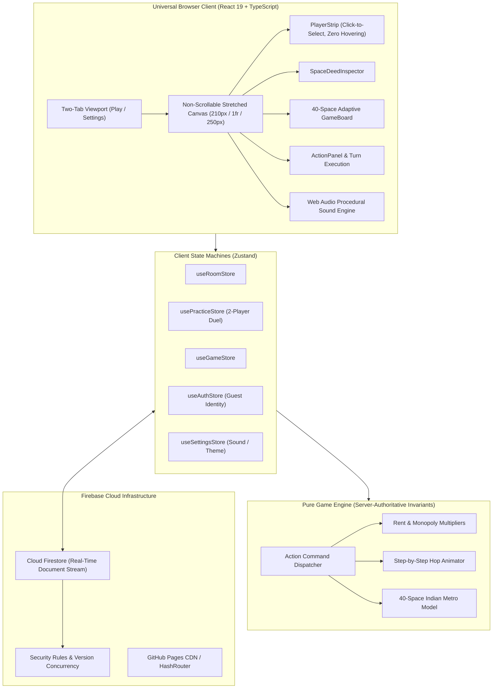

# 🇮🇳 Indian Monopoly — Online Multiplayer Board Game

[](https://github.com/K-692/Monopoly-India-Game/actions/workflows/ci.yml)
[](https://k-692.github.io/Monopoly-India-Game/)
[](LICENSE)
[](https://www.typescriptlang.org/)
[](https://react.dev/)
[](https://tailwindcss.com/)
[](https://vite.dev/)
[](https://playwright.dev/)

> **Live Game URL:** [https://k-692.github.io/Monopoly-India-Game/](https://k-692.github.io/Monopoly-India-Game/)
>
> **Repository Description:** A fast, responsive, Indian-themed multiplayer property trading board game built with React 19, TypeScript, Tailwind CSS, and Cloud Firestore. Features frictionless link-based room joining, 20 unique metropolitan cities with tier-wise ascending prices, 4 national utility grids, 4 intercity transit gateways, edge-to-edge maximum window-stretched board geometry, compact left player panel with click-to-select inspection (zero hover dependencies), bold high-legibility typography, state-change glowing feedback, in-board animated 3D dice, persistent center buzz cards, host-configurable rule engines, turn countdown timers, zero-latency Web Audio sound synthesis, and a 2-player practice match duel sandbox.
>
> **GitHub Repository Topics:** `monopoly`, `board-game`, `multiplayer-game`, `react19`, `typescript`, `firebase`, `firestore`, `tailwindcss`, `vite`, `playwright`, `game-engine`, `indian-theme`, `web-audio-api`, `pwa`, `responsive-web-design`, `github-pages`

---

## 🌟 Key Highlights

- 🌐 **Live Web Play**: Share the link [https://k-692.github.io/Monopoly-India-Game/](https://k-692.github.io/Monopoly-India-Game/) with friends to play directly from any modern desktop, tablet, or smartphone web browser!
- 🤺 **2-Player Practice Match Duel**: Fast, responsive 1v1 practice sandbox against *Priya (Mumbai)* with intelligent autonomous AI decision-making (rolling, property evaluation, bail resolution, and turn cycling).
- 📐 **Maximum Window-Stretched Board**: The board stretches horizontally left-to-right covering the maximum available window width (`1fr` dynamic allocation between sleek compact panels `[210px_1fr_250px]`), utilizing up to 76% of modern widescreen displays.
- 🗂️ **Compact Left Panel & Click-to-Select Player Info**: Replaced unstable hover popovers with an intentional, ergonomic click-to-select model. Clicking any player card immediately displays their liquid cash, net worth, board position, jail status, and interactive properties portfolio.
- 🔤 **High-Legibility Places & Prices Typography**: Large, bold fonts for all spaces (`text-[10.5px] sm:text-[12.5px] font-extrabold` for city names; `text-[10px] sm:text-[12px] font-black` for Rupee amounts) with proportional, balanced cell dimensions.
- 🏰 **20 Unique Indian Metropolitan Cities**: 40 canonical board spaces featuring 20 unique metropolitan economic centres with strictly ascending tier-wise prices (from *Jaipur* at ₹600 to *Mumbai* at ₹4,000), 4 transit gateways (*CST Mumbai*, *Howrah*, *Chennai Central*, *New Delhi*), 4 public utilities (*Bharat Telecom*, *Urja Power Grid*, *Jal Board*, *National Gas Grid*), *GST Checkposts*, and 2 persistent center decks (*Civic Fund* & *Market Buzz*).
- 🔗 **Frictionless Link-Based Multiplayer**: No Google login or password needed. Anyone with the room link can join instantly by simply entering their chosen player name!
- 🗂️ **Streamlined Two-Tab Interface**: Clean, uncluttered UI featuring only **Play** and **Settings** tabs. Settings and lobby tabs are naturally scrollable; only the active playboard is strictly non-scrollable.
- 💫 **State-Change Glowing & Zoom Effect**: When game state changes (pawns step or land, deeds are bought, cash transfers occur), affected board tiles and player cards activate an animated amber neon glow ring (`scale-105 animate-pulse`) so every player immediately sees live gameplay updates.
- 🔍 **Space Deed Inspector**: Positioned directly beneath player info on the left panel. Clicking any space opens its complete deed schedule (purchase price, base/house/tower rent tiers, mortgage values, and owner development controls).
- ⚡ **Streamlined Action Panel & Click Portfolio**: The right panel focuses cleanly on active turn operations (Roll The Dice, Buy/Decline, Pay Bail, End Turn) and personal finances with click-to-expand property portfolios.
- 🎨 **Dynamic Buyer-Color Ownership**: Spaces remain clean and uncolored while unowned. Once purchased by a player, the space dynamically adopts that **player's assigned token color** with an owner badge and building pips.
- 🚶‍♂️ **Step-by-Step Pawn Walking Animation**: Pawns physically hop tile by tile along the lane at a 140ms cadence with synchronized procedural step audio until reaching their destination space.
- 🎲 **High-Visibility 3D Tumbling Dice**: High-contrast white dice with solid black pips and 3D tumbling animations, accompanied by a rolled total summary pill.
- 📜 **Visible Buzz Card Contents**: The two center decks (*Civic Fund* and *Market Buzz*) permanently display their **actual card contents, titles, and amounts** face-up inside the board center with clean English terminology.
- ⏱️ **Turn Timer on Active Player**: The countdown timer is cleanly integrated directly onto the active player's card in the left panel with pulse warnings under 10s.
- ⚙️ **Host-Customizable Rules**: The game host can configure starting cash (₹10,000–₹25,000), pass START rewards (₹1,000–₹3,000), turn timer limits, max players (2–6), jail bail amounts, and monopoly rent multipliers before creating the room.

---

## 🎲 40-Space Canonical Board Topology

```
+----------------------------------------------------------------------------------------------------+
| REST      | AHMEDABAD | MARKET  | PUNE      | HYDERABAD | CHENNAI   | BENGALURU | CHENNAI   | GO TO    |
| HOUSE     | (₹2,200)  | BUZZ    | (₹2,200)  | (₹2,400)  | CENTRAL   | (₹2,600)  | (₹2,600)  | JAIL     |
| (20)      | (21)      | (22)    | (23)      | (24)      | (25)      | (26)      | (27)      | (30)     |
+-----------+-----------------------------------------------------------------------------+----------+
| GOA (19)  |                                                                             | JAL      |
| ₹2,000    |                                                                             | BOARD    |
|-----------+                                                                             | (28)     |
| KOCHI     |                            INDIAN MONOPOLY                                  +----------|
| (18)      |                  Real-Time Universal Multiplayer Web App                    | KOLKATA  |
| ₹1,800    |                                                                             | (29)     |
|-----------+                                                                             | ₹2,800   |
| CIVIC     |                                                                             +----------|
| FUND (17) |                                                                             | CHANDI-  |
|-----------+                                                                             | GARH(31) |
| VISAKHA-  |                                                                             | ₹3,000   |
| PATNAM(16)|                                                                             +----------|
| ₹1,800    |                                                                             | GURUGRAM |
|-----------+                                                                             | (32)     |
| HOWRAH    |                                                                             | ₹3,000   |
| JUNCTION  |                                                                             +----------|
| (15)      |                                                                             | CIVIC    |
|-----------+                                                                             | FUND (33)|
| SURAT     |                                                                             +----------|
| (14)      |                                                                             | GAS      |
| ₹1,600    |                                                                             | GRID(34) |
|-----------+                                                                             +----------|
| BHOPAL    |                                                                             | NEW DELHI|
| (13)      |                                                                             | TERMINAL |
| ₹1,400    |                                                                             | (35)     |
|-----------+                                                                             +----------|
| URJA      |                                                                             | MARKET   |
| POWER     |                                                                             | BUZZ (36)|
| (12)      |                                                                             +----------|
|-----------+                                                                             | NEW DELHI|
| INDORE    |                                                                             | (37)     |
| (11)      |                                                                             | ₹3,500   |
| ₹1,400    |                                                                             +----------|
|-----------+                                                                             | INFRA    |
| JAIL /    |                                                                             | LEVY(38) |
| VISITING  |                                                                             +----------|
| (10)      |                                                                             | MUMBAI   |
|           |                                                                             | (39)     |
|           |                                                                             | ₹4,000   |
+-----------+-----------------------------------------------------------------------------+----------+
|           | TELECOM   | VARANASI | MARKET   | LUCKNOW   | CST       | GST       | JODHPUR   | CIVIC    | JAIPUR   | START    |
|           | GRID (9)  | (8)      | BUZZ (7) | (6)       | MUMBAI(5) | CHECK(4)  | (3)       | FUND (2) | (1)      | (0)      |
|           | ₹1,500    | ₹1,000   |          | ₹1,000    | ₹2,000    | ₹2,000    | ₹600      |          | ₹600     | Collect  |
|           |           |          |          |           |           |           |           |          |          | ₹2,000   |
+----------------------------------------------------------------------------------------------------+
```

---

## 🏗️ System Architecture & Workflow



---

## 🚀 Getting Started

### Prerequisites
- Node.js 18.0+ or 20.0+
- npm 9.0+

### Installation

1. **Clone the repository:**
   ```bash
   git clone https://github.com/K-692/Monopoly-India-Game.git
   cd Monopoly-India-Game
   ```

2. **Install dependencies:**
   ```bash
   npm install
   ```

3. **Launch the development server:**
   ```bash
   npm run dev
   ```
   Open your browser to `http://localhost:5173`.

### Running Tests

- **Unit and game engine tests:**
  ```bash
  npm test
  ```
- **End-to-end browser tests (Playwright):**
  ```bash
  npx playwright test
  ```
- **Production build check:**
  ```bash
  npm run build
  ```

---

## 🤝 Contributing

We warmly welcome contributions from developers, designers, and board game enthusiasts worldwide! 

Whether you are improving AI bot strategies, optimizing responsive CSS grid topologies, adding sound effects, or fixing edge cases in monopoly rent rules:
1. **Fork the repository** on GitHub.
2. **Create a descriptive feature branch**: `git checkout -b feature/my-new-feature`
3. **Commit your changes**: `git commit -m "Add innovative new feature"`
4. **Push to your branch**: `git push origin feature/my-new-feature`
5. **Open a Pull Request** with a detailed summary of your improvements.

Please ensure all tests pass (`npm test && npm run build`) before opening a PR!

---

## 📄 License

This project is licensed under the **MIT License** — see the [LICENSE](LICENSE) file for complete details.
