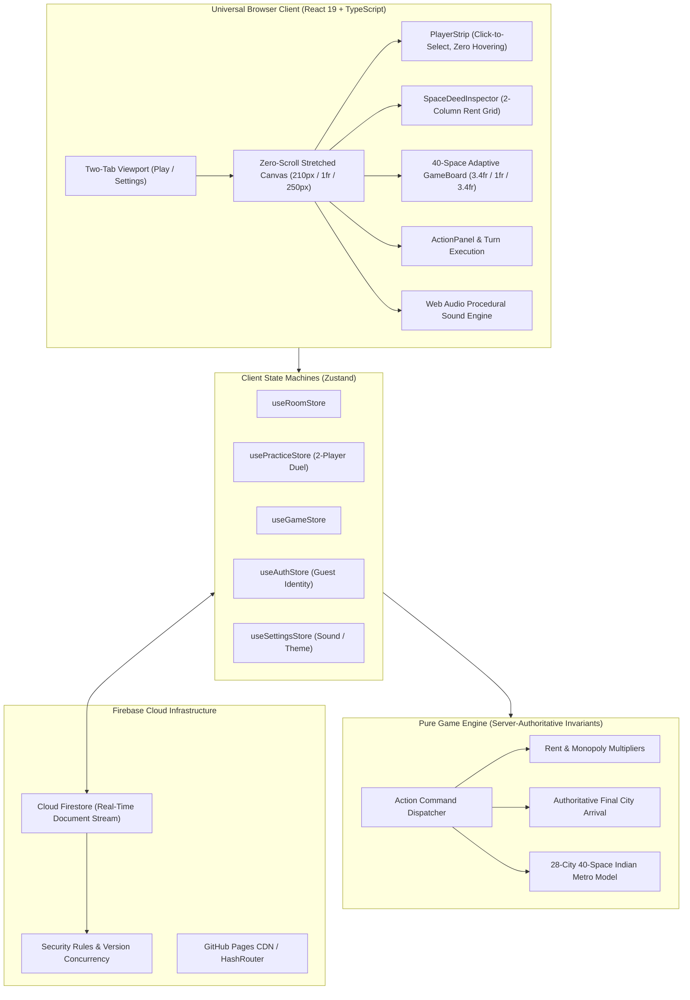

# 🇮🇳 Indian Monopoly — Online Multiplayer Board Game

[](https://github.com/K-692/Monopoly-India-Game/actions/workflows/ci.yml)
[](https://k-692.github.io/Monopoly-India-Game/)
[](LICENSE)
[](https://www.typescriptlang.org/)
[](https://react.dev/)
[](https://tailwindcss.com/)
[](https://vite.dev/)
[](https://playwright.dev/)

> **Live Game URL:** [https://k-692.github.io/Monopoly-India-Game/](https://k-692.github.io/Monopoly-India-Game/)
>
> **Repository Description:** A fast, responsive, zero-scroll Indian-themed multiplayer property trading board game built with React 19, TypeScript, Tailwind CSS, and Cloud Firestore. Features 28 authentic Indian metropolitan cities (strictly 7 per side), 2 Civic Fund spaces, 2 Market Buzz spaces, 4 intercity transit gateways, decreased center area with enlarged perimeter cells, single-line non-wrapping city typography (`whitespace-nowrap`), non-obscuring corner pawn tokens, frictionless link-based room joining, direct final destination presentation without walkover flicker, compact left player panel with click-to-select inspection (zero hover dependencies), in-board animated 3D dice, persistent center buzz cards, host-configurable rule engines, turn countdown timers, zero-latency Web Audio sound synthesis, and a 2-player practice match duel sandbox.
>
> **GitHub Repository Topics:** `monopoly`, `board-game`, `multiplayer-game`, `react19`, `typescript`, `firebase`, `firestore`, `tailwindcss`, `vite`, `playwright`, `game-engine`, `indian-theme`, `web-audio-api`, `pwa`, `responsive-web-design`, `zero-scroll`, `github-pages`

---

## 🌟 Key Highlights

- 🌐 **Live Web Play**: Share the link [https://k-692.github.io/Monopoly-India-Game/](https://k-692.github.io/Monopoly-India-Game/) with friends to play directly from any modern desktop, tablet, or smartphone web browser!
- 🚫 **Zero-Scroll Game Tab Guarantee**: The entire game tab is strictly non-scrollable (`h-[calc(100dvh-54px)] overflow-hidden`). No board scroll, no left panel scroll, no right panel scroll, and no inner container scrollbars.
- 📐 **Compact Extreme Corners & Spacious City Grids**: Asymmetrical grid geometry (`1.25fr repeat(9, 1fr) 1.25fr` and `1.45fr repeat(9, 1fr) 1.45fr`) places Rest House, Jail, START, and Go To Jail in compact boxes at the extreme four corners, liberating **78.3% of the board width** for the top and bottom city lanes (~84px–92px wide each).
- 🔤 **Two-Line City Grid Architecture**: Every city grid is cleanly formatted across exactly **two distinct lines**:
  - **First Line**: City / Place Name (`text-[11px] sm:text-[12px] md:text-[12.5px] font-extrabold whitespace-nowrap overflow-hidden text-ellipsis`).
  - **Second Line**: Price / Fine Amount (`text-[10px] sm:text-[11px] md:text-[11.5px] font-black text-emerald-700 dark:text-emerald-400`).
- 🏙️ **28 Authentic Indian Cities (7 Cities on Each Side)**:
  - **Bottom Side**: Jaipur, Jodhpur, Udaipur, Agra, Lucknow, Amritsar, Varanasi (7 cities) + 1 Civic Fund + 1 Transit (CST Mumbai).
  - **Left Side**: Indore, Bhopal, Surat, Nagpur, Visakhapatnam, Kochi, Goa (7 cities) + 1 Market Buzz + 1 Transit (Howrah Junction).
  - **Top Side**: Ahmedabad, Pune, Hyderabad, Coimbatore, Bengaluru, Chennai, Kolkata (7 cities) + 1 Civic Fund + 1 Transit (Chennai Central).
  - **Right Side**: Chandigarh, Gurugram, Noida, Dehradun, Navi Mumbai, New Delhi, Mumbai (7 cities) + 1 Market Buzz + 1 Transit (New Delhi Terminal).
- 🎁 **2 Civic Fund & 2 Market Buzz Placements**: Symmetrically balanced on opposite sides of the board (Civic Fund on Spaces 2 & 22, Market Buzz on Spaces 12 & 32).
- ♟️ **Non-Obscuring Corner Pawn Tokens**: Player tokens sit as compact floating badges in the tile corners, ensuring player pawns never obscure or block city names or Rupee prices.
- 🎯 **Direct Destination Arrival & Final City Presentation**: When dice roll, pawns land directly at the destination tile rather than displaying confusing intermediate walkover steps. The final city is immediately highlighted and selected in the deed inspector.
- 🤺 **2-Player Practice Match Duel**: Fast, responsive 1v1 practice sandbox against *Priya (Mumbai)* with intelligent autonomous AI decision-making (rolling, property evaluation, bail resolution, and turn cycling).
- 🗂️ **Compact Left Panel & Click-to-Select Player Info**: Replaced unstable hover popovers with an intentional, ergonomic click-to-select model. Clicking any player card immediately displays their liquid cash, net worth, board position, jail status, and interactive properties portfolio.
- 🔗 **Frictionless Link-Based Multiplayer**: No Google login or password needed. Anyone with the room link can join instantly by simply entering their chosen player name!
- 🗂️ **Streamlined Two-Tab Interface**: Clean, uncluttered UI featuring only **Play** and **Settings** tabs. Settings and lobby tabs are naturally scrollable; only the active playboard is strictly non-scrollable.
- 💫 **State-Change Glowing & Zoom Effect**: When game state changes (deeds are bought, upgraded, or landed upon), affected board tiles activate an animated amber neon glow ring (`scale-105 animate-pulse`) so every player immediately sees live gameplay updates.
- 🔍 **Space Deed Inspector**: Positioned directly beneath player info on the left panel with a space-saving 2-column rent schedule. Clicking any space opens its complete deed schedule (purchase price, base/house/tower rent tiers, mortgage values, and owner development controls).
- ⚡ **Streamlined Action Panel & Click Portfolio**: The right panel focuses cleanly on active turn operations (Roll The Dice, Buy/Decline, Pay Bail, End Turn) and personal finances with compact property chips.
- 🎨 **Dynamic Buyer-Color Ownership**: Spaces remain clean and uncolored while unowned. Once purchased by a player, the space dynamically adopts that **player's assigned token color** with an owner badge and building pips.
- 🎲 **High-Visibility 3D Tumbling Dice**: High-contrast white dice with solid black pips and 3D tumbling animations, accompanied by a rolled total summary pill.
- 📜 **Visible Buzz Card Contents**: The two center decks (*Civic Fund* and *Market Buzz*) permanently display their actual card contents, titles, and amounts face-up inside the board center.
- ⏱️ **Turn Timer on Active Player**: The countdown timer is cleanly integrated directly onto the active player's card in the left panel with pulse warnings under 10s.
- ⚙️ **Host-Customizable Rules**: The game host can configure starting cash (₹10,000–₹25,000), pass START rewards (₹1,000–₹3,000), turn timer limits, max players (2–6), jail bail amounts, and monopoly rent multipliers before creating the room.

---

## 🎲 40-Space Canonical Board Topology (7 Cities Per Side)

```
+--------------------------------------------------------------------------------------------------------------------+
| REST      | AHMEDABAD | CIVIC     | PUNE      | HYDERABAD | CHENNAI   | COIMBA-   | BENGALURU | CHENNAI   | KOLKATA   | GO TO     |
| HOUSE     | (₹2,200)  | FUND      | (₹2,200)  | (₹2,400)  | CENTRAL   | TORE      | (₹2,600)  | (₹2,600)  | (₹2,800)  | JAIL      |
| (20)      | (21)      | (22)      | (23)      | (24)      | (25)      | (26)      | (27)      | (28)      | (29)      | (30)      |
+-----------+-----------+-----------+-----------+-----------+-----------+-----------+-----------+-----------+-----------+-----------+
| GOA (19)  |                                                                                                           | CHANDI-   |
| ₹2,000    |                                                                                                           | GARH (31) |
|-----------+                                                                                                           | ₹3,000    |
| KOCHI     |                                              INDIAN MONOPOLY                                              +-----------|
| (18)      |                                  Real-Time Universal Multiplayer Web App                                  | MARKET    |
| ₹1,800    |                                                                                                           | BUZZ (32) |
|-----------+                                                                                                           +-----------|
| VISAKHA-  |                                                                                                           | GURUGRAM  |
| PATNAM(17)|                                                                                                           | (33)      |
| ₹1,800    |                                                                                                           | ₹3,200    |
|-----------+                                                                                                           +-----------|
| NAGPUR    |                                                                                                           | NOIDA     |
| (16)      |                                                                                                           | (34)      |
| ₹1,600    |                                                                                                           | ₹3,000    |
|-----------+                                                                                                           +-----------|
| HOWRAH    |                                                                                                           | NEW DELHI |
| JUNCTION  |                                                                                                           | TERMINAL  |
| (15)      |                                                                                                           | (35)      |
|-----------+                                                                                                           +-----------|
| SURAT     |                                                                                                           | DEHRADUN  |
| (14)      |                                                                                                           | (36)      |
| ₹1,600    |                                                                                                           | ₹3,200    |
|-----------+                                                                                                           +-----------|
| BHOPAL    |                                                                                                           | NAVI      |
| (13)      |                                                                                                           | MUMBAI(37)|
| ₹1,400    |                                                                                                           | ₹3,500    |
|-----------+                                                                                                           +-----------|
| MARKET    |                                                                                                           | NEW DELHI |
| BUZZ (12) |                                                                                                           | (38)      |
|           |                                                                                                           | ₹3,800    |
|-----------+                                                                                                           +-----------|
| INDORE    |                                                                                                           | MUMBAI    |
| (11)      |                                                                                                           | (39)      |
| ₹1,400    |                                                                                                           | ₹4,000    |
+-----------+-----------------------------------------------------------------------------------------------------------+-----------+
| JAIL /    | VARANASI  | AMRITSAR  | LUCKNOW   | AGRA      | CST       | UDAIPUR   | JODHPUR   | CIVIC     | JAIPUR    | START     |
| VISITING  | (9)       | (8)       | (7)       | (6)       | MUMBAI(5) | (4)       | (3)       | FUND (2)  | (1)       | (0)       |
| (10)      | ₹1,200    | ₹1,200    | ₹1,000    | ₹1,000    | ₹2,000    | ₹800      | ₹600      |           | ₹600      | Collect   |
|           |           |           |           |           |           |           |           |           |           | ₹2,000    |
+-----------------------------------------------------------------------------------------------------------------------------------+
```

---

## 🏗️ System Architecture & Workflow



---

## 🚀 Getting Started

### Prerequisites
- Node.js 18.0+ or 20.0+
- npm 9.0+

### Installation

1. **Clone the repository:**
   ```bash
   git clone https://github.com/K-692/Monopoly-India-Game.git
   cd Monopoly-India-Game
   ```

2. **Install dependencies:**
   ```bash
   npm install
   ```

3. **Launch the development server:**
   ```bash
   npm run dev
   ```
   Open your browser to `http://localhost:5173`.

### Running Tests

- **Unit and game engine tests:**
  ```bash
  npm test
  ```
- **End-to-end browser tests (Playwright):**
  ```bash
  npx playwright test
  ```
- **Production build check:**
  ```bash
  npm run build
  ```

---

## 🤝 Contributing

We warmly welcome contributions from developers, designers, and board game enthusiasts worldwide! 

Whether you are improving AI bot strategies, optimizing responsive CSS grid topologies, adding sound effects, or fixing edge cases in monopoly rent rules:
1. **Fork the repository** on GitHub.
2. **Create a descriptive feature branch**: `git checkout -b feature/my-new-feature`
3. **Commit your changes**: `git commit -m "Add innovative new feature"`
4. **Push to your branch**: `git push origin feature/my-new-feature`
5. **Open a Pull Request** with a detailed summary of your improvements.

Please ensure all tests pass (`npm test && npm run build`) before opening a PR!

---

## 📄 License

This project is licensed under the **MIT License** — see the [LICENSE](LICENSE) file for complete details.
