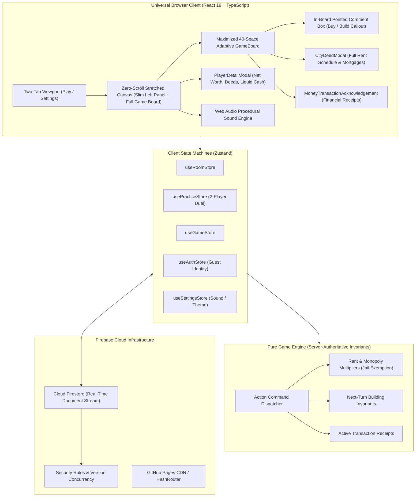

# 🇮🇳 Indian Monopoly — Online Multiplayer Board Game

[](https://github.com/K-692/Monopoly-India-Game/actions/workflows/ci.yml)
[](https://k-692.github.io/Monopoly-India-Game/)
[](LICENSE)
[](https://www.typescriptlang.org/)
[](https://react.dev/)
[](https://tailwindcss.com/)
[](https://vite.dev/)
[](https://playwright.dev/)

> **Live Game URL:** [https://k-692.github.io/Monopoly-India-Game/](https://k-692.github.io/Monopoly-India-Game/)
>
> **Repository Description:** A fast, responsive, zero-scroll Indian-themed multiplayer property trading board game built with React 19, TypeScript, Tailwind CSS, and Cloud Firestore. Features a maximized full-screen board, 24 authentic Indian metropolitan cities (strictly 6 per side) formatted in two non-wrapping lines with prices and mortgage values, 4 intercity transit gateways (2 Railways & 2 Airports with in-grid vector illustrations), 12 Market Buzz & 12 Civic Fund canonical rules displayed in dual indexed center panels (#1 to #12), central 3D tumbling dice and in-board roll button, in-board pointed comment boxes for buying cities and constructing houses/towers, interactive City Deed Inspection Modals on city click, Player Financial Dossier Modals on player click, jailed player rent exemption, money transaction acknowledgement receipts, player-colored grid theming upon purchase, next-turn delayed building logic, universal mortgaging, frictionless link-based room joining, host-configurable rule engines, turn countdown timers, zero-latency Web Audio procedural sound synthesis, and a 2-player practice match duel sandbox.
>
> **GitHub Repository Topics:** `monopoly`, `board-game`, `multiplayer-game`, `react19`, `typescript`, `firebase`, `firestore`, `tailwindcss`, `vite`, `playwright`, `game-engine`, `indian-theme`, `web-audio-api`, `pwa`, `responsive-web-design`, `zero-scroll`, `github-pages`

---

## 🌟 Key Highlights

- 🌐 **Live Web Play**: Share the link [https://k-692.github.io/Monopoly-India-Game/](https://k-692.github.io/Monopoly-India-Game/) with friends to play directly from any modern desktop, tablet, or smartphone web browser!
- 🚫 **Zero-Scroll Full-Screen Board**: The board stretches horizontally and vertically across all available viewport space (`h-[calc(100dvh-50px)]`, `flex-1`). No page scrolling, no right panel clutter, and no bottom footer.
- 🎯 **Pointed Comment Box for Buy & Build**: Replaced bulky side panels with an elegant in-board callout box anchored directly to the player's position on the perimeter grid. Features an exact geometric pointer triangle directed straight at the player's active tile for purchasing properties or constructing houses and commercial towers.
- 🏙️ **City Deed Inspection Modal (Click Any City)**: Clicking any city grid on the board opens a deed inspection modal showing space index, color band, ownership status, purchase price, mortgage value, unmortgage cost, complete rent schedule (Base, House 1-4, Commercial Tower), and direct mortgage/unmortgage controls.
- 👤 **Player Financial Dossier Modal (Click Any Player)**: Clicking any player's name card in the slim left panel opens an in-depth financial dossier showing liquid cash, total net worth, current position, jail status, and their complete portfolio of owned deeds with current rent yields.
- 🧾 **Money Transaction Acknowledgement Modal**: Whenever money changes hands (rent payments, property deeds, construction costs, statutory taxes, START rewards), a financial receipt modal appears with payer, recipient, amount, description, and an explicit, high-contrast, gold `✓ ACKNOWLEDGE` button.
- ⚖️ **Jailed Player Rent & Card Exemption**: Incarcerated players in Central Jail earn **₹0 rent** when opponents land on their properties and receive **₹0** from card payment redistributions until bailed or released.
- 🎲 **Central Roll Dice Button & 3D Tumbling Dice**: Interactive 3D dice faces with tumbling animations and the primary action button (`ROLL DICE`, `END TURN`, `TRY DOUBLES`, `PAY BAIL`) placed directly at the center of the board.
- 📜 **Dual 1..12 Indexed Rule Panels in Board Center**: In place of static card backs or single face-up cards, the center of the board features two structured panels:
  - **Left Panel (Civic Fund)**: All 12 Community Treasury rules indexed #1 to #12 with titles, descriptions, and currency awards.
  - **Right Panel (Market Buzz)**: All 12 Fortune & Chance rules indexed #1 to #12 with titles, descriptions, and currency amounts.
  - Landing on Civic Fund or Market Buzz resolves the applied rule index strictly from the player's rolled `diceTotal` ($1 \le \text{diceTotal} \le 12$) with an in-board pop-up modal featuring a prominent, high-visibility `✓ ACKNOWLEDGE RULE` button.
- 🎨 **Player-Colored Grid Theming on Purchase**:
  - When a player buys a city, the grid tile adopts that player's token color:
    - **Solid Border**: 2px border in the player's token color.
    - **Tinted Background**: Alpha-blended wash in the player's color (`${colorToken}18`).
    - **Owner Accent Bar**: Header strip displaying the owner's name.
    - **Houses/Tower Badges**: Direct in-grid house badges (`🏠`) or golden Commercial Tower (`🏢 TOWER`).
- 🏗️ **Delayed Building Logic (Next Turn Construction Constraint)**:
  - House/tower construction is strictly prohibited on the turn a city is purchased. Building is permitted starting from subsequent turns (`turnNumber > boughtOnTurn`) when the owner visits their city with sufficient funds.
- 🔤 **Two-Line Non-Wrapping Typography with Mortgage Values**: Every city and transit grid is formatted strictly across **two distinct lines**:
  - **Line 1 (Top)**: City / Place Name with dynamic length-based font scaling (`text-[7px]` to `text-[9.5px]`), guaranteeing zero text wrap and zero truncation.
  - **Line 2 (Bottom)**: Price alongside Mortgage Value (`M: ₹{mortgageValue}`) in bold, legible typography.
- 🚂 ✈️ **In-Grid Railway & Airport Vector Illustrations**:
  - **Railways**: CST Mumbai (#5) and Howrah Railway (#15) feature crisp, vector express locomotive engine illustrations with headlights and track ties.
  - **Airports**: Chennai Airport (#25) and IGI Airport (#35) feature streamlined high-altitude passenger jetliner airliner illustrations.
- 🏙️ **24 Authentic Indian Cities (Strictly 6 Cities on Each Side)**:
  - **Bottom Side**: Jaipur, Jodhpur, Udaipur, Agra, Lucknow, Varanasi (6 cities) + 1 Civic Fund + 1 Railway (CST Mumbai) + 1 Tax (GST Tax).
  - **Left Side**: Indore, Bhopal, Surat, Visakhapatnam, Kochi, Goa (6 cities) + 1 Market Buzz + 1 Railway (Howrah Railway) + 1 Utility (Urja Power Grid).
  - **Top Side**: Ahmedabad, Pune, Hyderabad, Bengaluru, Chennai, Kolkata (6 cities) + 1 Civic Fund + 1 Airport (Chennai Airport) + 1 Utility (Jal Board Grid).
  - **Right Side**: Chandigarh, Gurugram, Noida, Navi Mumbai, New Delhi, Mumbai (6 cities) + 1 Market Buzz + 1 Airport (IGI Airport) + 1 Tax (Infra Levy).
- 🤺 **2-Player Practice Match Duel**: Fast, responsive 1v1 practice sandbox against *Priya (Mumbai)* with intelligent autonomous AI decision-making (rolling, property evaluation, bail resolution, and turn cycling).
- 🔗 **Frictionless Link-Based Multiplayer**: No Google login or password needed. Anyone with the room link can join instantly by simply entering their chosen player name!
- 🗂️ **Streamlined Two-Tab Interface**: Clean, uncluttered UI featuring only **Play** and **Settings** tabs.

---

## 🎲 40-Space Canonical Board Topology (6 Cities Per Side)

```
+--------------------------------------------------------------------------------------------------------------------+
| REST      | AHMEDABAD | CIVIC     | PUNE      | HYDERABAD | CHENNAI   | BENGALURU | CHENNAI   | JAL BOARD | KOLKATA   | GO TO     |
| HOUSE     | (₹2,200)  | FUND      | (₹2,200)  | (₹2,400)  | AIRPORT   | (₹2,600)  | (₹2,600)  | GRID      | (₹2,800)  | JAIL      |
| (20)      | (21)      | (22)      | (23)      | (24)      | [✈️] (25)  | (26)      | (27)      | (28)      | (29)      | (30)      |
+-----------+-----------+-----------+-----------+-----------+-----------+-----------+-----------+-----------+-----------+-----------+
| GOA (19)  |                                                                                                           | CHANDI-   |
| ₹2,000    |                                                                                                           | GARH (31) |
|-----------+                                                                                                           | ₹3,000    |
| KOCHI     |                                              INDIAN MONOPOLY                                              +-----------|
| (18)      |                                  Real-Time Universal Multiplayer Web App                                  | MARKET    |
| ₹1,800    |                                                                                                           | BUZZ (32) |
|-----------+                                                                                                           +-----------|
| URJA      |                                                                                                           | GURUGRAM  |
| POWER(17) |                                                                                                           | (33)      |
| ₹1,500    |                                                                                                           | ₹3,200    |
|-----------+                                                                                                           +-----------|
| VISAKHA-  |                                                                                                           | NOIDA     |
| PATNAM(16)|                                                                                                           | (34)      |
| ₹1,800    |                                                                                                           | ₹3,200    |
|-----------+                                                                                                           +-----------|
| HOWRAH    |                                                                                                           | IGI       |
| RAILWAY   |                                                                                                           | AIRPORT   |
| [🚂] (15) |                                                                                                           | [✈️] (35)  |
|-----------+                                                                                                           +-----------|
| SURAT     |                                                                                                           | NAVI      |
| (14)      |                                                                                                           | MUMBAI(36)|
| ₹1,600    |                                                                                                           | ₹3,500    |
|-----------+                                                                                                           +-----------|
| BHOPAL    |                                                                                                           | INFRA     |
| (13)      |                                                                                                           | LEVY (37) |
| ₹1,400    |                                                                                                           | ₹1,000    |
|-----------+                                                                                                           +-----------|
| MARKET    |                                                                                                           | NEW DELHI |
| BUZZ (12) |                                                                                                           | (38)      |
|           |                                                                                                           | ₹3,800    |
|-----------+                                                                                                           +-----------|
| INDORE    |                                                                                                           | MUMBAI    |
| (11)      |                                                                                                           | (39)      |
| ₹1,400    |                                                                                                           | ₹4,000    |
+-----------+-----------------------------------------------------------------------------------------------------------+-----------+
| JAIL /    | VARANASI  | GST TAX   | LUCKNOW   | AGRA      | CST       | UDAIPUR   | JODHPUR   | CIVIC     | JAIPUR    | START     |
| VISITING  | (9)       | (8)       | (7)       | (6)       | MUMBAI(5) | (4)       | (3)       | FUND (2)  | (1)       | (0)       |
| (10)      | ₹1,200    | ₹2,000    | ₹1,000    | ₹1,000    | [🚂]₹2,000| ₹800      | ₹600      | Treasury  | ₹600      | Collect   |
|           |           |           |           |           |           |           |           |           |           | ₹2,000    |
+-----------------------------------------------------------------------------------------------------------------------------------+
```

---

## 🏗️ System Architecture & Workflow



---

## 🚀 Getting Started

### Prerequisites
- Node.js 18.0+ or 20.0+
- npm 9.0+

### Installation

1. **Clone the repository:**
   ```bash
   git clone https://github.com/K-692/Monopoly-India-Game.git
   cd Monopoly-India-Game
   ```

2. **Install dependencies:**
   ```bash
   npm install
   ```

3. **Launch the development server:**
   ```bash
   npm run dev
   ```
   Open your browser to `http://localhost:5173`.

### Running Tests

- **Unit and game engine tests:**
   ```bash
   npm test
   ```
- **End-to-end browser tests (Playwright):**
   ```bash
   npx playwright test
   ```
- **Production build check:**
   ```bash
   npm run build
   ```

---

## 🤝 Contributing

We warmly welcome contributions from developers, designers, and board game enthusiasts worldwide! 

Whether you are improving AI bot strategies, optimizing responsive CSS grid topologies, adding sound effects, or fixing edge cases in monopoly rent rules:
1. **Fork the repository** on GitHub.
2. **Create a descriptive feature branch**: `git checkout -b feature/my-new-feature`
3. **Commit your changes**: `git commit -m "Add innovative new feature"`
4. **Push to your branch**: `git push origin feature/my-new-feature`
5. **Open a Pull Request** with a detailed summary of your improvements.

Please ensure all tests pass (`npm test && npm run build`) before opening a PR!

---

## 📄 License

This project is licensed under the **MIT License** — see the [LICENSE](LICENSE) file for complete details.
