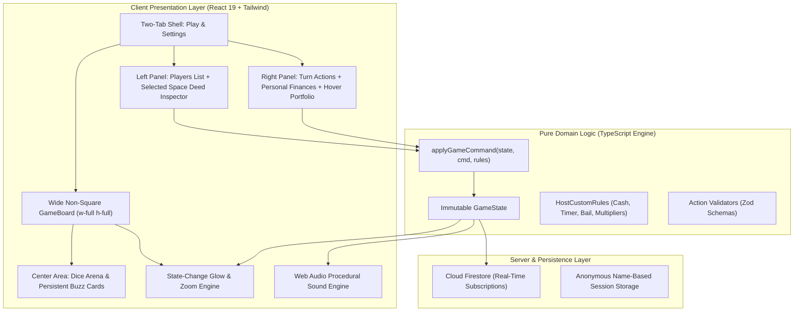

# 🇮🇳 Indian Monopoly — Online Multiplayer Board Game

[](https://github.com/K-692/Monopoly-India-Game/actions/workflows/ci.yml)
[](https://k-692.github.io/Monopoly-India-Game/)
[](LICENSE)
[](https://www.typescriptlang.org/)
[](https://react.dev/)
[](https://tailwindcss.com/)
[](https://vite.dev/)
[](https://playwright.dev/)

> **Live Game URL:** [https://k-692.github.io/Monopoly-India-Game/](https://k-692.github.io/Monopoly-India-Game/)
>
> **Repository Description:** A fast, responsive, Indian-themed multiplayer property trading board game built with React 19, TypeScript, Tailwind CSS, and Cloud Firestore. Features frictionless link-based room joining, 20 unique metropolitan cities with tier-wise ascending prices, 4 national utility grids, 4 intercity transit gateways, wide non-square adaptive board geometry, state-change glowing feedback, in-board animated 3D dice, persistent center buzz cards, host-configurable rule engines, turn countdown timers, zero-latency Web Audio sound synthesis, and a modular practice match sandbox.
>
> **GitHub Repository Topics:** `monopoly`, `board-game`, `multiplayer-game`, `react19`, `typescript`, `firebase`, `firestore`, `tailwindcss`, `vite`, `playwright`, `game-engine`, `indian-theme`, `web-audio-api`, `pwa`, `responsive-web-design`, `github-pages`

---

## 🌟 Key Highlights

- 🌐 **Live Web Play**: Share the link [https://k-692.github.io/Monopoly-India-Game/](https://k-692.github.io/Monopoly-India-Game/) with friends to play directly from any modern desktop, tablet, or smartphone web browser!
- 🏰 **20 Unique Indian Metropolitan Cities**: 40 canonical board spaces featuring 20 unique metropolitan economic centres with strictly ascending tier-wise prices (from *Jaipur* at ₹600 to *Mumbai* at ₹4,000), 4 transit gateways (*CST Mumbai*, *Howrah*, *Chennai Central*, *New Delhi*), 4 public utilities (*Bharat Telecom*, *Urja Power Grid*, *Jal Board*, *National Gas Grid*), *GST Checkposts*, and 2 persistent center decks (*Civic Fund* & *Market Buzz*).
- 🔗 **Frictionless Link-Based Multiplayer**: No Google login or password needed. Anyone with the room link can join instantly by simply entering their chosen player name!
- 🗂️ **Streamlined Two-Tab Interface**: Clean, uncluttered UI featuring only **Play** and **Settings** tabs. Settings and lobby tabs are naturally scrollable; only the active playboard is strictly non-scrollable.
- 📐 **Wide Non-Square Adaptive Board**: The board maxes out the available width and height of the central column (`w-full h-full max-h-full mx-auto`) with no square aspect-ratio limitation, giving expansive horizontal space for crystal-clear city names and prices.
- 💫 **State-Change Glowing & Zoom Effect**: When game state changes (pawns step or land, deeds are bought, cash transfers occur), affected board tiles and player cards activate an animated amber neon glow ring (`scale-105 animate-pulse`) so every player immediately sees live gameplay updates.
- 🔍 **Space Deed Inspector on Left Panel**: Positioned directly beneath the compact player list in the left panel. Clicking any space opens its complete deed schedule (purchase price, base/house/tower rent tiers, mortgage values, and owner development controls).
- ⚡ **Streamlined Action Panel & Hover Portfolio**: The right panel focuses cleanly on active turn operations (Roll The Dice, Buy/Decline, Pay Bail, End Turn) and personal finances. Under "My Info", property assets are cleanly hidden from default view and revealed via an interactive hover card on cursor hover.
- 🎨 **Dynamic Buyer-Color Ownership**: Spaces remain clean and uncolored while unowned. Once purchased by a player, the space dynamically adopts that **player's assigned token color** with an owner badge and building pips.
- 🚶‍♂️ **Step-by-Step Pawn Walking Animation**: Pawns physically hop tile by tile along the lane at a 140ms cadence with synchronized procedural step audio until reaching their destination space.
- 🎲 **High-Visibility 3D Tumbling Dice**: High-contrast white dice with solid black pips and 3D tumbling animations, accompanied by a rolled total summary pill.
- 📜 **Visible Buzz Card Contents**: The two center decks (*Civic Fund* and *Market Buzz*) permanently display their **actual card contents, titles, and amounts** face-up inside the board center with clean English terminology.
- ⏱️ **Turn Timer on Active Player**: The countdown timer is cleanly integrated directly onto the active player's card in the left panel with pulse warnings under 10s.
- ⚙️ **Host-Customizable Rules**: The game host can configure starting cash (₹10,000–₹25,000), pass START rewards (₹1,000–₹3,000), turn timer limits, max players (2–6), jail bail amounts, and monopoly rent multipliers before creating the room.
- 🎯 **Practice Match (Gameplay Sandbox)**: A dedicated practice match on the Play tab to test the exact gameplay features against 3 simulated opponents. Modular and easily removable in future releases.

---

## 🎲 40-Space Canonical Board Topology

```
+----------------------------------------------------------------------------------------------------+
| REST      | AHMEDABAD | MARKET  | PUNE      | HYDERABAD | CHENNAI   | BENGALURU | CHENNAI   | GO TO    |
| HOUSE     | (₹2,200)  | BUZZ    | (₹2,200)  | (₹2,400)  | CENTRAL   | (₹2,600)  | (₹2,600)  | JAIL     |
| (20)      | (21)      | (22)    | (23)      | (24)      | (25)      | (26)      | (27)      | (30)     |
+-----------+-----------------------------------------------------------------------------+----------+
| GOA (19)  |                                                                             | JAL      |
| ₹2,000    |                                                                             | BOARD    |
|-----------+                                                                             | (28)     |
| KOCHI     |                            INDIAN MONOPOLY                                  +----------|
| (18)      |                  Real-Time Universal Multiplayer Web App                    | KOLKATA  |
| ₹1,800    |                                                                             | (29)     |
|-----------+                                                                             | ₹2,800   |
| CIVIC     |                                                                             +----------|
| FUND (17) |                                                                             | CHANDI-  |
|-----------+                                                                             | GARH(31) |
| VISAKHA-  |                                                                             | ₹3,000   |
| PATNAM(16)|                                                                             +----------|
| ₹1,800    |                                                                             | GURUGRAM |
|-----------+                                                                             | (32)     |
| HOWRAH    |                                                                             | ₹3,000   |
| JUNCTION  |                                                                             +----------|
| (15)      |                                                                             | CIVIC    |
|-----------+                                                                             | FUND (33)|
| SURAT     |                                                                             +----------|
| (14)      |                                                                             | GAS      |
| ₹1,600    |                                                                             | GRID(34) |
|-----------+                                                                             +----------|
| BHOPAL    |                                                                             | NEW DELHI|
| (13)      |                                                                             | TERMINAL |
| ₹1,400    |                                                                             | (35)     |
|-----------+                                                                             +----------|
| URJA      |                                                                             | MARKET   |
| POWER     |                                                                             | BUZZ (36)|
| (12)      |                                                                             +----------|
|-----------+                                                                             | NEW DELHI|
| INDORE    |                                                                             | (37)     |
| (11)      |                                                                             | ₹3,500   |
| ₹1,400    |                                                                             +----------|
|-----------+                                                                             | INFRA    |
| JAIL /    |                                                                             | LEVY(38) |
| VISITING  |                                                                             +----------|
| (10)      |                                                                             | MUMBAI   |
|           |                                                                             | (39)     |
|           |                                                                             | ₹4,000   |
+-----------+-----------------------------------------------------------------------------+----------+
|           | TELECOM   | VARANASI | MARKET   | LUCKNOW   | CST       | GST       | JODHPUR   | CIVIC    | JAIPUR   | START    |
|           | GRID (9)  | (8)      | BUZZ (7) | (6)       | MUMBAI(5) | CHECK(4)  | (3)       | FUND (2) | (1)      | (0)      |
|           | ₹1,500    | ₹1,000   |          | ₹1,000    | ₹2,000    | ₹2,000    | ₹600      |          | ₹600     | Collect  |
|           |           |          |          |           |           |           |           |          |          | ₹2,000   |
+----------------------------------------------------------------------------------------------------+
```

---

## 🏗️ System Architecture & Workflow



---

## 🚀 Quick Start & Installation

### Prerequisites
- **Node.js**: v18.0.0 or later (v20+ recommended)
- **npm**: v9.0.0 or later

### Installation

```bash
# Clone the repository
git clone https://github.com/K-692/Monopoly-India-Game.git

# Enter repository root
cd Monopoly-India-Game

# Install all dependencies cleanly
npm install
```

### Running Locally

```bash
# Start local development server with HMR
npm run dev
```

Visit `http://localhost:5173` in your browser.

### Quality Verification & Testing

```bash
# Run static type checking
npm run typecheck

# Run ESLint code quality checks
npm run lint

# Run pure domain engine Vitest unit tests
npm run test

# Run multi-device Playwright E2E tests (27 device configurations)
npx playwright test

# Build production bundle
npm run build
```

---

## 🌐 Enabling GitHub Pages (One-Time Setup)

To enable live hosting on GitHub Pages so anyone with the link can play:

1. Open your GitHub repository in your browser:
   `https://github.com/K-692/Monopoly-India-Game/settings/pages`
2. Under **Build and deployment**:
   - Set **Source** to **GitHub Actions** (recommended) or choose **Deploy from a branch (`gh-pages` / root)**.
3. Once enabled, the game is accessible worldwide at:
   **[https://k-692.github.io/Monopoly-India-Game/](https://k-692.github.io/Monopoly-India-Game/)**

---

## 🤝 Welcoming Contributors

We warmly welcome contributions from the community! Whether you want to improve game mechanics, enhance procedural soundscapes, refine responsive mobile layouts, or report issues:

1. **Fork the Repo**: Click the **Fork** button on GitHub.
2. **Create a Feature Branch**:
   ```bash
   git checkout -b feature/amazing-feature
   ```
3. **Commit Your Changes**: Follow clear, conventional commit messages.
4. **Push to Your Branch**:
   ```bash
   git push origin feature/amazing-feature
   ```
5. **Open a Pull Request**: Submit your PR with a concise description of the feature or bugfix.

Please ensure all tests and type checks pass prior to opening a PR (`npm run typecheck && npm run test && npm run lint`).

---

## 📄 License

Distributed under the **MIT License**. See `LICENSE` for more information.
