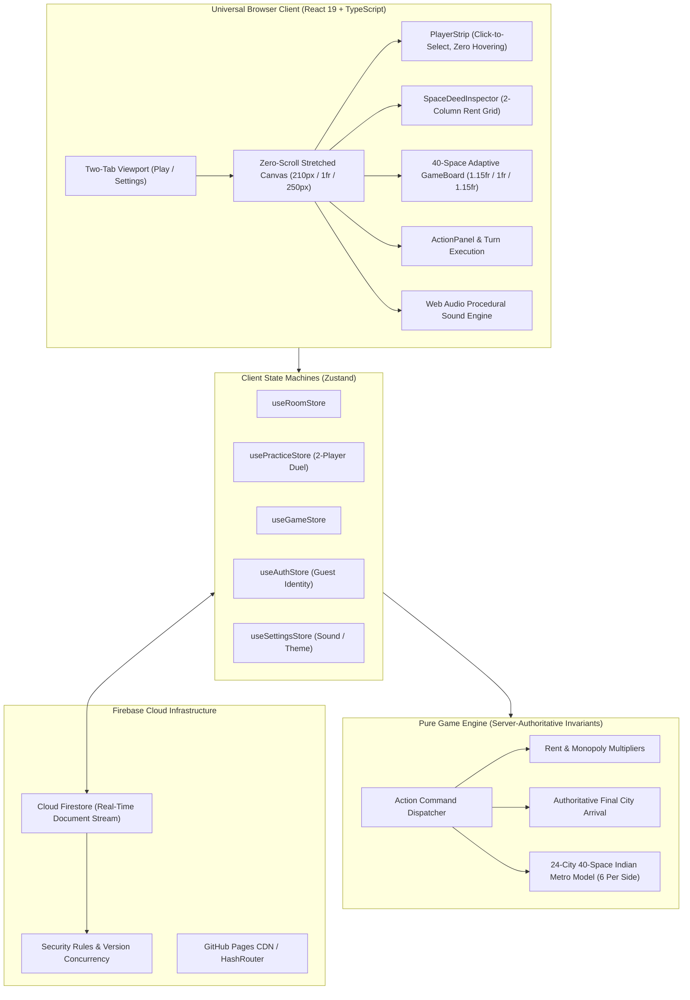

# 🇮🇳 Indian Monopoly — Online Multiplayer Board Game

[](https://github.com/K-692/Monopoly-India-Game/actions/workflows/ci.yml)
[](https://k-692.github.io/Monopoly-India-Game/)
[](LICENSE)
[](https://www.typescriptlang.org/)
[](https://react.dev/)
[](https://tailwindcss.com/)
[](https://vite.dev/)
[](https://playwright.dev/)

> **Live Game URL:** [https://k-692.github.io/Monopoly-India-Game/](https://k-692.github.io/Monopoly-India-Game/)
>
> **Repository Description:** A fast, responsive, zero-scroll Indian-themed multiplayer property trading board game built with React 19, TypeScript, Tailwind CSS, and Cloud Firestore. Features 24 authentic Indian metropolitan cities (strictly 6 per side), 4 intercity transit gateways (2 Railways & 2 Airports with in-grid vector illustrations), 12 Market Buzz & 12 Civic Fund canonical rules displayed in dual indexed center panels (#1 to #12), central 3D tumbling dice, dice-total card rule trigger with an in-board pop-up modal, player-colored grid theming upon purchase (colored border, tinted background, and owner banner), next-turn delayed building logic, universal mortgaging at first or action step, dismissible left panel player inspector with cross button, enlarged player pawns with dedicated non-overlapping slots, compact extreme corners, two-line non-wrapping city typography with adaptive font sizing, frictionless link-based room joining, host-configurable rule engines, turn countdown timers, zero-latency Web Audio sound synthesis, and a 2-player practice match duel sandbox.
>
> **GitHub Repository Topics:** `monopoly`, `board-game`, `multiplayer-game`, `react19`, `typescript`, `firebase`, `firestore`, `tailwindcss`, `vite`, `playwright`, `game-engine`, `indian-theme`, `web-audio-api`, `pwa`, `responsive-web-design`, `zero-scroll`, `github-pages`

---

## 🌟 Key Highlights

- 🌐 **Live Web Play**: Share the link [https://k-692.github.io/Monopoly-India-Game/](https://k-692.github.io/Monopoly-India-Game/) with friends to play directly from any modern desktop, tablet, or smartphone web browser!
- 🚫 **Zero-Scroll Game Tab Guarantee**: The entire game tab is strictly non-scrollable (`h-[calc(100dvh-54px)] overflow-hidden`). No board scroll, no left panel scroll, no right panel scroll, and no inner container scrollbars.
- 📐 **Spacious Grid Proportions & Compact Extreme Corners**: Perimeter grid geometry (`1.35fr repeat(9, 1fr) 1.35fr` and `1.4fr repeat(9, 1fr) 1.4fr`) expands top/bottom cells by 40% and left/right cells by 35%, while placing Rest House, Jail, START, and Go To Jail in compact boxes at the extreme four corners.
- 📜 **Dual 1..12 Indexed Rule Panels in Board Center**: In place of static card backs or single face-up cards, the center of the board features two structured panels:
  - **Left Panel (Civic Fund)**: All 12 Community Treasury rules indexed #1 to #12 with titles, descriptions, and currency awards.
  - **Right Panel (Market Buzz)**: All 12 Fortune & Chance rules indexed #1 to #12 with titles, descriptions, and currency amounts.
  - Active rules light up with a vibrant pulse ring matching the rolled dice total.
- 🎲 **Dice-Total Card Rule Selection & Pop-up Modal Window**:
  - Landing on Civic Fund or Market Buzz selects the exact rule matching the player's rolled `diceTotal` (index 1 to 12).
  - A modal dialog appears displaying the deck name, rule title, description, currency amount, and explicit `🎲 Dice Total: X` badge with an "Acknowledge Rule" button.
- 🎨 **Player-Colored Grid Theming on Purchase**:
  - When a player buys a city, the grid tile adopts that player's token color:
    - **Solid Border**: 2px border in the player's token color.
    - **Tinted Background**: Alpha-blended wash in the player's color (`${colorToken}18`).
    - **Owner Accent Bar**: Header strip displaying the owner's name.
    - **Houses/Tower Badges**: Direct in-grid house badges (`🏠`) or golden Commercial Tower (`🏢 TOWER`).
  - Unowned properties maintain clean, neutral parchment aesthetics.
- 🏗️ **Delayed Building Logic (Next Turn Construction Constraint)**:
  - House/tower construction is strictly prohibited on the turn a city is purchased. Building is permitted starting from subsequent turns (`turnNumber > boughtOnTurn`) when the owner visits their city with sufficient funds.
- ♟️ **Dedicated Non-Overlapping Player Pawn Slots**:
  - Player pawns sit in dedicated flex rows facing the board center, separated from city names, transit illustrations, and price tags. Overlap is mathematically impossible.
- 🔤 **Two-Line Non-Wrapping Typography**: Every city and transit grid is formatted strictly across **two distinct lines**:
  - **Line 1 (Top)**: City / Place Name with dynamic length-based font scaling (`text-[7px]` to `text-[9.5px]`), guaranteeing **zero text wrap and zero truncation**.
  - **Line 2 (Bottom)**: Price / Fine Amount in bold emerald or crimson (`text-[8px]` to `text-[9px] font-black`).
- 🚂 ✈️ **In-Grid Railway & Airport Vector Illustrations**:
  - **Railways**: CST Mumbai (#5) and Howrah Railway (#15) feature crisp, vector express locomotive engine illustrations with headlights and track ties.
  - **Airports**: Chennai Airport (#25) and IGI Airport (#35) feature streamlined high-altitude passenger jetliner airliner illustrations.
- 🏙️ **24 Authentic Indian Cities (Strictly 6 Cities on Each Side)**:
  - **Bottom Side**: Jaipur, Jodhpur, Udaipur, Agra, Lucknow, Varanasi (6 cities) + 1 Civic Fund + 1 Railway (CST Mumbai) + 1 Tax (GST Tax).
  - **Left Side**: Indore, Bhopal, Surat, Visakhapatnam, Kochi, Goa (6 cities) + 1 Market Buzz + 1 Railway (Howrah Railway) + 1 Utility (Urja Power Grid).
  - **Top Side**: Ahmedabad, Pune, Hyderabad, Bengaluru, Chennai, Kolkata (6 cities) + 1 Civic Fund + 1 Airport (Chennai Airport) + 1 Utility (Jal Board Grid).
  - **Right Side**: Chandigarh, Gurugram, Noida, Navi Mumbai, New Delhi, Mumbai (6 cities) + 1 Market Buzz + 1 Airport (IGI Airport) + 1 Tax (Infra Levy).
- 🎁 **2 Civic Fund & 2 Market Buzz Placements**: Symmetrically balanced on opposite sides of the board (Civic Fund on Spaces 2 & 22, Market Buzz on Spaces 12 & 32).
- 🎯 **Direct Destination Arrival & Final City Presentation**: When dice roll, pawns land directly at the destination tile. The final city is immediately highlighted and selected in the deed inspector.
- 🤺 **2-Player Practice Match Duel**: Fast, responsive 1v1 practice sandbox against *Priya (Mumbai)* with intelligent autonomous AI decision-making (rolling, property evaluation, bail resolution, and turn cycling).
- 🗂️ **Compact Left Panel & Click-to-Select Player Info**: Replaced unstable hover popovers with an intentional, ergonomic click-to-select model with a dedicated cross button (`X`) to close the player inspector.
- 💰 **Universal Mortgaging at First or Action Step**: Any player can mortgage or redeem any city they own whenever they hold the turn, whether in the first step (`AWAIT_ROLL`) or during action resolution (`MANAGEMENT`, `PROPERTY_DECISION`).
- 🔗 **Frictionless Link-Based Multiplayer**: No Google login or password needed. Anyone with the room link can join instantly by simply entering their chosen player name!
- 🗂️ **Streamlined Two-Tab Interface**: Clean, uncluttered UI featuring only **Play** and **Settings** tabs.
- 💫 **State-Change Glowing & Zoom Effect**: When game state changes (deeds are bought, upgraded, or landed upon), affected board tiles activate an animated amber neon glow ring (`scale-105 animate-pulse`).
- 🔍 **Space Deed Inspector**: Space-saving 2-column rent schedule displaying complete deed details (purchase price, base/house/tower rent tiers, mortgage values, and owner development controls).
- ⚙️ **Host-Customizable Rules**: The game host can configure starting cash (₹10,000–₹25,000), pass START rewards (₹1,000–₹3,000), turn timer limits, max players (2–6), jail bail amounts, and monopoly rent multipliers.

---

## 🎲 40-Space Canonical Board Topology (6 Cities Per Side)

```
+--------------------------------------------------------------------------------------------------------------------+
| REST      | AHMEDABAD | CIVIC     | PUNE      | HYDERABAD | CHENNAI   | BENGALURU | CHENNAI   | JAL BOARD | KOLKATA   | GO TO     |
| HOUSE     | (₹2,200)  | FUND      | (₹2,200)  | (₹2,400)  | AIRPORT   | (₹2,600)  | (₹2,600)  | GRID      | (₹2,800)  | JAIL      |
| (20)      | (21)      | (22)      | (23)      | (24)      | [✈️] (25)  | (26)      | (27)      | (28)      | (29)      | (30)      |
+-----------+-----------+-----------+-----------+-----------+-----------+-----------+-----------+-----------+-----------+-----------+
| GOA (19)  |                                                                                                           | CHANDI-   |
| ₹2,000    |                                                                                                           | GARH (31) |
|-----------+                                                                                                           | ₹3,000    |
| KOCHI     |                                              INDIAN MONOPOLY                                              +-----------|
| (18)      |                                  Real-Time Universal Multiplayer Web App                                  | MARKET    |
| ₹1,800    |                                                                                                           | BUZZ (32) |
|-----------+                                                                                                           +-----------|
| URJA      |                                                                                                           | GURUGRAM  |
| POWER(17) |                                                                                                           | (33)      |
| ₹1,500    |                                                                                                           | ₹3,200    |
|-----------+                                                                                                           +-----------|
| VISAKHA-  |                                                                                                           | NOIDA     |
| PATNAM(16)|                                                                                                           | (34)      |
| ₹1,800    |                                                                                                           | ₹3,200    |
|-----------+                                                                                                           +-----------|
| HOWRAH    |                                                                                                           | IGI       |
| RAILWAY   |                                                                                                           | AIRPORT   |
| [🚂] (15) |                                                                                                           | [✈️] (35)  |
|-----------+                                                                                                           +-----------|
| SURAT     |                                                                                                           | NAVI      |
| (14)      |                                                                                                           | MUMBAI(36)|
| ₹1,600    |                                                                                                           | ₹3,500    |
|-----------+                                                                                                           +-----------|
| BHOPAL    |                                                                                                           | INFRA     |
| (13)      |                                                                                                           | LEVY (37) |
| ₹1,400    |                                                                                                           | ₹1,000    |
|-----------+                                                                                                           +-----------|
| MARKET    |                                                                                                           | NEW DELHI |
| BUZZ (12) |                                                                                                           | (38)      |
|           |                                                                                                           | ₹3,800    |
|-----------+                                                                                                           +-----------|
| INDORE    |                                                                                                           | MUMBAI    |
| (11)      |                                                                                                           | (39)      |
| ₹1,400    |                                                                                                           | ₹4,000    |
+-----------+-----------------------------------------------------------------------------------------------------------+-----------+
| JAIL /    | VARANASI  | GST TAX   | LUCKNOW   | AGRA      | CST       | UDAIPUR   | JODHPUR   | CIVIC     | JAIPUR    | START     |
| VISITING  | (9)       | (8)       | (7)       | (6)       | MUMBAI(5) | (4)       | (3)       | FUND (2)  | (1)       | (0)       |
| (10)      | ₹1,200    | ₹2,000    | ₹1,000    | ₹1,000    | [🚂]₹2,000| ₹800      | ₹600      | Treasury  | ₹600      | Collect   |
|           |           |           |           |           |           |           |           |           |           | ₹2,000    |
+-----------------------------------------------------------------------------------------------------------------------------------+
```

---

## 🏗️ System Architecture & Workflow



---

## 🚀 Getting Started

### Prerequisites
- Node.js 18.0+ or 20.0+
- npm 9.0+

### Installation

1. **Clone the repository:**
   ```bash
   git clone https://github.com/K-692/Monopoly-India-Game.git
   cd Monopoly-India-Game
   ```

2. **Install dependencies:**
   ```bash
   npm install
   ```

3. **Launch the development server:**
   ```bash
   npm run dev
   ```
   Open your browser to `http://localhost:5173`.

### Running Tests

- **Unit and game engine tests:**
  ```bash
  npm test
  ```
- **End-to-end browser tests (Playwright):**
  ```bash
  npx playwright test
  ```
- **Production build check:**
  ```bash
  npm run build
  ```

---

## 🤝 Contributing

We warmly welcome contributions from developers, designers, and board game enthusiasts worldwide! 

Whether you are improving AI bot strategies, optimizing responsive CSS grid topologies, adding sound effects, or fixing edge cases in monopoly rent rules:
1. **Fork the repository** on GitHub.
2. **Create a descriptive feature branch**: `git checkout -b feature/my-new-feature`
3. **Commit your changes**: `git commit -m "Add innovative new feature"`
4. **Push to your branch**: `git push origin feature/my-new-feature`
5. **Open a Pull Request** with a detailed summary of your improvements.

Please ensure all tests pass (`npm test && npm run build`) before opening a PR!

---

## 📄 License

This project is licensed under the **MIT License** — see the [LICENSE](LICENSE) file for complete details.
