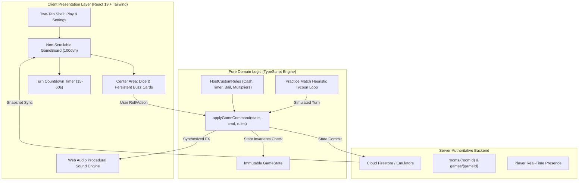

# 🇮🇳 Indian Monopoly — Online Multiplayer Board Game

[](https://github.com/K-692/Monopoly-India-Game/actions/workflows/ci.yml)
[](LICENSE)
[](https://www.typescriptlang.org/)
[](https://react.dev/)
[](https://tailwindcss.com/)
[](https://vite.dev/)
[](https://playwright.dev/)

> **Repository Description:** A fast, responsive, Indian-themed multiplayer property trading board game built with React 19, TypeScript, Tailwind CSS, and Cloud Firestore. Features frictionless link-based room joining, in-board animated 3D dice, persistent center buzz cards, host-configurable rule engines, turn countdown timers, zero-latency Web Audio sound synthesis, and a modular practice match.
>
> **GitHub Repository Topics:** `monopoly`, `board-game`, `multiplayer-game`, `react19`, `typescript`, `firebase`, `firestore`, `tailwindcss`, `vite`, `playwright`, `game-engine`, `indian-theme`, `web-audio-api`, `pwa`, `responsive-web-design`

---

## 🌟 Key Highlights

- 🏰 **Authentic Indian Board**: 40 spaces featuring 22 major Indian city properties (from *Jaipur MI Road* to *Mumbai Marine Drive*), 4 transit networks, 2 utilities (*Urja Power Grid* & *Jal Board*), *GST Checkposts*, and 2 persistent center decks (*Civic Fund* & *Market Buzz*).
- 🔗 **Frictionless Link-Based Multiplayer**: No Google login or password needed. Anyone with the room link can join instantly by simply entering their chosen player name!
- 🗂️ **Streamlined Two-Tab Interface**: Clean, uncluttered UI featuring only **Play** and **Settings** tabs. Settings and lobby tabs are naturally scrollable; only the active playboard is strictly non-scrollable.
- 📐 **Complete & Viewport-Adaptive Board**: Guaranteed full board visibility—the board scales dynamically to available vertical height (`h-full max-h-full aspect-square w-auto max-w-full`) so START, Central Jail, and bottom tiles are never cut off.
- 🚶 **Widened Walk Lane**: Perimeter walk lanes are 45% wider (`1.5fr` outer tracks), ensuring property titles, city names, and prices are clearly placed and legible without awkward truncation.
- 🎨 **Dynamic Buyer-Color Ownership**: Spaces remain clean and uncolored while unowned. Once purchased by a player, the space dynamically adopts that **player's chosen token color** with an owner badge and building pips.
- 🚶‍♂️ **Step-by-Step Pawn Walking Animation**: Pawns physically hop tile by tile along the lane at a 140ms cadence with synchronized procedural step audio until reaching their destination space.
- 🎲 **High-Visibility 3D Tumbling Dice**: High-contrast white dice with solid black pips and 3D tumbling animations, accompanied by a rolled total summary pill.
- 👥 **Compact Player Cards with Hover Flyouts**: Minimalist player rows on the left panel. Hovering over any player reveals a rich portfolio flyout (cash, net worth, board position, jail status, and owned deeds categorized by color groups).
- 👤 **Right-Panel "My Info" Portfolio**: Placed directly below the "Roll The Dice" button, displaying your personal cash, net worth, position, and property assets at a glance.
- 📜 **Visible Buzz Card Contents**: The two center decks (*Civic Fund* and *Market Buzz*) permanently display their **actual card contents, titles, and amounts** face-up inside the board center.
- ⏱️ **Turn Timer on Active Player**: The countdown timer is cleanly integrated directly onto the active player's card in the left panel with pulse warnings under 10s.
- 🚦 **Turn Step Acknowledgments**: An interactive breadcrumb pipeline (`1. Roll ➔ 2. Action ➔ 3. Complete`) provides instant visual confirmations for rolls, movements, purchases, and rents.
- ⚙️ **Host-Customizable Rules**: The game host can configure starting cash (₹10,000–₹25,000), pass START rewards (₹1,000–₹3,000), turn timer limits, max players (2–6), jail bail amounts, and monopoly rent multipliers before creating the room.
- 🎯 **Practice Match (Gameplay Sandbox)**: A dedicated practice match on the Play tab to test the exact gameplay features against 3 simulated opponents. Modular and easily removable in future releases.

---

## 🎲 Board Layout & Topology

```
+---------------------------------------------------------------------------------------------+
| REST    | HYDERABAD | MARKET | HYDERABAD | BENGALURU | CHENNAI | BENGALURU | KOLKATA | GO TO|
| HOUSE   | CYBER TW  |  BUZZ  | HI-TECH   | MG ROAD   | CENTRAL | BRIGADE RD| PARK ST | JAIL |
| (20)    | (21)      | (22)   | (23)      | (24)      | (25)    | (26)      | (27)    | (30) |
+---------+-------------------------------------------------------------------------+---------+
| KOZHIKODE                                                                         | KOLKATA |
| (19)                                                                              | (31)    |
|---------+                                                                         +---------|
| KOCHI                                🇮🇳 INDIAN MONOPOLY                           | JAL     |
| (18)                                                                              | BOARD   |
|---------+                         Server-Authoritative Multi-Device               | (32)    |
| CIVIC                                                                             +---------|
| FUND                                                                              | BHUBAN- |
| (17)                                                                              | ESHWAR  |
|---------+                                                                         | (33)    |
| THIRUVAN-                                                                         +---------|
| ANTHAPURAM                                                                        | CHENNAI |
| (16)                                                                              | (34)    |
|---------+                                                                         +---------|
| HOWRAH                                                                            | DELHI   |
| METRO                                                                             | METRO   |
| (15)                                                                              | (35)    |
|---------+                                                                         +---------|
| SURAT                                                                             | MARKET  |
| (14)                                                                              | BUZZ    |
|---------+                                                                         | (36)    |
| VADODARA                                                                          +---------|
| (13)                                                                              | CHENNAI |
|---------+                                                                         | BOAT CL |
| URJA                                                                              | (37)    |
| POWER                                                                             +---------|
| (12)                                                                              | INFRA   |
|---------+                                                                         | LEVY    |
| AHMEDABAD                                                                         | (38)    |
| (11)                                                                              | +-------|
|---------+                                                                         | DELHI CP|
| JAIL /                                                                            | (39)    |
| VISITING+-------------------------------------------------------------------------+---------+
| (10)    | AGRA    | VARANASI | LUCKNOW | MUMBAI  | GST       | JODHPUR | CIVIC | JAIPUR | START|
|         | (9)     | (8)      | (6)     | LOCAL(5)| CHECKPOST | (3)     | FUND  | (1)    | (0)  |
+---------------------------------------------------------------------------------------------+
```

---

## 🏗️ System Architecture & Workflow



---

## 🔐 Storing Firebase Credentials in GitHub Secrets

To keep credentials completely secure and prevent committing keys to Git history:

1. Open your repository on GitHub: `https://github.com/K-692/Monopoly-India-Game`
2. Go to **Settings** > **Secrets and variables** > **Actions**.
3. Click **New repository secret** and add:
   - `VITE_FIREBASE_API_KEY`: Your Firebase Web API key
   - `VITE_FIREBASE_AUTH_DOMAIN`: `your-project.firebaseapp.com`
   - `VITE_FIREBASE_PROJECT_ID`: `your-project-id`
   - `VITE_FIREBASE_STORAGE_BUCKET`: `your-project.firebasestorage.app`
   - `VITE_FIREBASE_MESSAGING_SENDER_ID`: `your-sender-id`
   - `VITE_FIREBASE_APP_ID`: `1:your-app-id:web:...`
   - `VITE_FIREBASE_MEASUREMENT_ID`: `G-XXXXXXXXXX`
   - `VITE_FIREBASE_DATABASE_URL`: `https://your-project.firebasedatabase.app`
4. The GitHub Actions workflow ([`.github/workflows/deploy-pages.yml`](.github/workflows/deploy-pages.yml)) injects these secrets into the production build during deployment.
5. See [docs/SECRETS_SETUP.md](docs/SECRETS_SETUP.md) for full step-by-step instructions.

---

## 🛠️ Tech Stack

| Layer | Technologies |
|---|---|
| **Frontend Framework** | [React 19](https://react.dev/) + [TypeScript 5.7](https://www.typescriptlang.org/) |
| **Build & Tooling** | [Vite 6](https://vite.dev/) |
| **Styling & Tokens** | [Tailwind CSS 3.4](https://tailwindcss.com/) + CSS Custom Properties |
| **UI Primitives** | [Radix UI](https://www.radix-ui.com/) + [Lucide Icons](https://lucide.dev/) |
| **Audio Engine** | Web Audio API (procedural synthesis for zero-latency cross-platform sound) |
| **Routing** | [React Router 7](https://reactrouter.com/) (HashRouter for GitHub Pages deep linking) |
| **State Management** | [Zustand](https://github.com/pmndrs/zustand) |
| **Backend & Cloud** | [Cloud Firestore](https://firebase.google.com/docs/firestore), [Cloud Functions](https://firebase.google.com/docs/functions) |
| **Testing** | [Vitest](https://vitest.dev/), [React Testing Library](https://testing-library.com/), [Playwright](https://playwright.dev/) |
| **Deployment** | GitHub Pages (Frontend) + GitHub Actions CI/CD |

---

## 🚀 Getting Started

### 1. Clone repository
```bash
git clone https://github.com/K-692/Monopoly-India-Game.git
cd Monopoly-India-Game
```

### 2. Install dependencies
```bash
npm install
```

### 3. Start local development server
```bash
npm run dev
```
Open `http://localhost:5173`. You can immediately launch the **Practice Match** or host/join rooms!

---

## 🧪 Testing & Quality Gates

```bash
# Run unit tests
npm run test

# Run TypeScript typechecks
npm run typecheck

# Run linter
npm run lint

# Run end-to-end multi-device browser tests
npm run test:e2e

# Run production build
npm run build
```

---

## 🤝 Contributing to Indian Monopoly

We welcome contributions from developers, designers, and board-game enthusiasts! To contribute:

1. **Fork the Repository**: Click the `Fork` button at the top right of the GitHub page.
2. **Clone your fork**:
   ```bash
   git clone https://github.com/<your-username>/Monopoly-India-Game.git
   cd Monopoly-India-Game
   ```
3. **Create a Feature Branch**:
   ```bash
   git checkout -b feat/your-awesome-feature
   ```
4. **Adhere to Code Standards**:
   - Write clean, type-safe TypeScript code.
   - Add comments explaining non-trivial business logic or mathematical algorithms.
   - Keep domain logic strictly isolated in pure functions within `src/domain/`.
5. **Verify Quality Gates**:
   - Run `npm run test` (Vitest must pass 100%).
   - Run `npm run typecheck` (0 TypeScript errors).
   - Run `npm run lint` (0 ESLint errors/warnings).
   - Run `npm run build` (production build must succeed).
   - Run `npm run test:e2e` (Playwright tests must pass across all screen sizes).
6. **Submit a Pull Request**:
   - Push your branch to GitHub: `git push origin feat/your-awesome-feature`
   - Open a Pull Request with a clear title and description of your enhancements.

---

## 📄 License

This project is licensed under the MIT License - see the [LICENSE](LICENSE) file for details.
