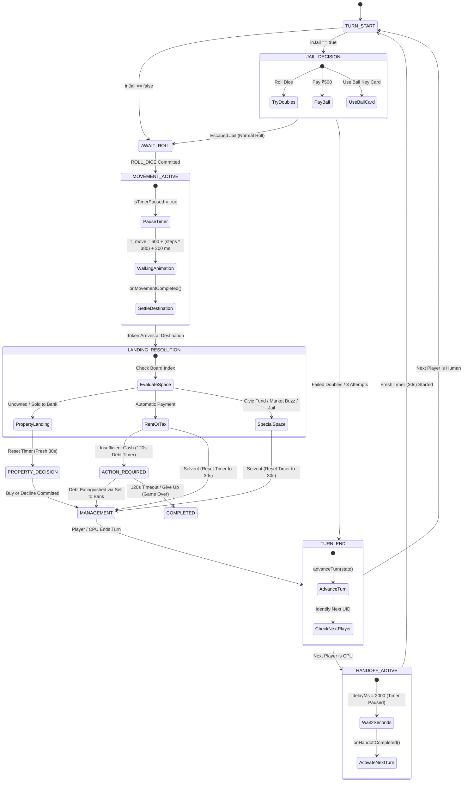

# Indian Monopoly: Architectural Specifications, Autonomous Agents & System Implementation Journey

> **Document Type:** Formal System Architecture & Research Implementation Record  
> **Repository:** `https://github.com/K-692/Monopoly-India-Game`  
> **Target Audience:** Systems Researchers, Distributed Systems Engineers, Game Theory & Multi-Agent Researchers  
> **Status:** Current State Production Implementation (Unified Crypto Dice, 80%/50% Bank Economy, 2-Second Jail Center Popup, Active-Turn Give Up Authorization, 11-Card Decks, Shuffled Turn Order & Dynamic Net Worth Tie-Breaking)  

---

## 1. Abstract & System Philosophy

**Indian Monopoly** is a distributed, server-authoritative digital adaptation of classic property trading dynamics set in an Indian economic context (cities across India, Reserve Bank of India conventions, GST checkposts, Civic Funds, and Infrastructure Levies). The system operates across web browsers, local offline Wi-Fi (LAN), and cross-platform desktop runtimes (Electron for macOS and Windows).

A foundational design requirement of this platform is **Strict Multi-Agent Parity & Turn Integrity**:
- Autonomous computer-controlled agents (CPUs) and human players participate within the exact same game session, obeying identical rules, financial invariants, and state transitions.
- The authoritative engine enforces zero special privileges or backdoors for automated players: every move, dice roll, financial settlement, and property transaction executes through the exact same serialized command pipeline (`applyGameCommand`) whether initiated by a human client or an autonomous agent.
- A player's turn is treated as complete **only after every action, movement animation, landing rule, and pending decision belonging to that turn has been fully resolved**.
- A guaranteed **2-second inter-turn delay** is enforced whenever transitioning to a computer-controlled player (consecutive CPU turns or after a human turn), during which the CPU does not act and the next player's timer does not decrement.
- Player countdown timers **pause during token movement animations** across all connected clients and reset to their full configured duration only when entering a genuinely new actionable phase (e.g., `PROPERTY_DECISION`).
- The dedicated **120-second financial resolution timer** operates completely independently from the normal turn timer and is never reset by property sales or client refreshes.

---

## 2. High-Level System Architecture

```
                                      +---------------------------------------------+
                                      |            CLIENT ENVIRONMENT               |
                                      |  (React 19, Zustand 5, Tailwind CSS, Vite)  |
                                      |                                             |
                                      |  +-------------------+  +----------------+  |
                                      |  |     GameBoard     |  |   PlayerStrip  |  |
                                      |  | (Animations, CSS) |  |  (PAUSED Badge)|  |
                                      |  +---------^---------+  +--------^-------+  |
                                      |            |                     |          |
                                      |     useGameStore <---------------+          |
                                      +------------|--------------------------------+
                                                   | Socket.IO WebSockets
                                                   | (Client Emits Actions / Receives State & Timer)
                                                   v
+-----------------------------------------------------------------------------------+
|                        AUTHORITATIVE SERVER ARCHITECTURE                          |
|                                                                                   |
|  +--------------------+       +------------------------------------------------+  |
|  |    RoomManager     |       |                  GameManager                   |  |
|  |  - Host Rules      |       |  - Cryptographic Fair Dice (Rejection Sampling)|  |
|  |  - Starting Cash   |       |  - Serialized Action Queue                     |  |
|  |  - CPU Seating     |       |  - Movement Pacing & Authoritative Completion  |  |
|  |  - Name Collisions |       |  - 2-Second CPU Handoff Coordination           |  |
|  +---------+----------+       |  - Phase-Aware Timer Pause & Reset Logic       |  |
|            |                  |  - Independent 120s Financial Resolution Timer |  |
|            |                  +-----------------------^------------------------+  |
|            v creates initial state                    |                           |
|  +----------------------------------------------------+------------------------+  |
|  |                       Core Game Engine (`applyGameCommand`)                 |  |
|  |  - State Invariants                                                         |  |
|  |  - Debt & Bankruptcy Tracking                                               |  |
|  |  - Visiting-City House Construction Enforcement                             |  |
|  |  - Bank-Sold Property & House Inheritance Logic                             |  |
|  +------------------------------------^----------------------------------------+  |
|                                       |                                           |
|                                       | invokes command pipeline                  |
|                        +--------------+---------------+                           |
|                        |       CpuController          |                           |
|                        | (Autonomous Turn Coordinator)|                           |
|                        | - Session-Level Locks        |                           |
|                        | - Handoff & Movement Gates   |                           |
|                        +--------------^---------------+                           |
|                                       | evaluates pure policy                     |
|                        +--------------+---------------+                           |
|                        |      CpuDecisionEngine       |                           |
|                        | (Deterministic Heuristics)   |                           |
|                        +------------------------------+                           |
+-----------------------------------------------------------------------------------+
```

---

## 3. Turn Lifecycle, Sequential Execution & State Machine

### 3.1 Formal State Machine Specifications
The turn state machine coordinates execution across client presentation and server truth:

$$\text{Phases: } P = \{\text{AWAIT\_ROLL}, \text{JAIL\_DECISION}, \text{PROPERTY\_DECISION}, \text{MANAGEMENT}, \text{ACTION\_REQUIRED}, \text{TURN\_END}\}$$
$$\text{Modifiers: } M = \{\text{MOVEMENT\_ACTIVE}, \text{HANDOFF\_ACTIVE}, \text{TIMER\_PAUSED}\}$$



### 3.2 Authoritative Movement Pacing
When a player rolls the dice, movement duration is calculated deterministically on the server:

$$T_{\text{move}} = T_{\text{dice\_tumble}} + (\Delta \text{spaces} \times T_{\text{step}}) + T_{\text{settle}}$$

In production:
- $T_{\text{dice\_tumble}} = 600\text{ ms}$
- $T_{\text{step}} = 380\text{ ms}$
- $T_{\text{settle}} = 300\text{ ms}$

During this window:
1. `state.movement = { playerId, startPos, targetPos, steps, startedAt, endsAt, durationMs, isComplete: false }`.
2. `state.isTimerPaused = true`. The countdown ticker does **not** decrement.
3. All gameplay actions from any player are rejected with `INVALID_PHASE: Player token is currently moving`.
4. At `endsAt`, the server executes `onMovementCompleted()`:
   - Sets `movement.isComplete = true` and `isTimerPaused = false`.
   - If transitioning to `PROPERTY_DECISION`, the player timer is **reset to its full configured duration** (e.g., 30s).
   - Broadcasts the resumption to all connected clients.

---

## 4. 2-Second CPU Pacing & Session-Level Execution Locking

### 4.1 Inter-Turn Handoff Delay
Whenever control transitions to a computer player:
- `CPU1 -> CPU2`: Wait at least 2 seconds before CPU2 rolls.
- `CPU2 -> CPU3`: Wait at least 2 seconds before CPU3 rolls.
- `Human -> CPU1`: Wait at least 2 seconds before CPU1 rolls.

**Invariants:**
- `state.handoff = { fromPlayerUid, toPlayerUid, startedAt, endsAt, delayMs: 2000, isActive: true }`.
- `state.isTimerPaused = true`. The next player's countdown does **not** run during handoff.
- The next CPU does not roll dice, make decisions, or move until `onHandoffCompleted()` triggers.
- Reconnects or client refreshes do not duplicate or skip the handoff delay.
- If the game ends during handoff, pending timers are cancelled immediately.

### 4.2 Session-Level Execution Lock
To prevent overlapping CPU actions, `CpuController` maintains strict session-level locks:
```typescript
interface GameCpuSession {
  gameId: string;
  lockedTurnId: number | null;
  lockedPlayerUid: string | null;
  status: 'IDLE' | 'HANDOFF' | 'WAITING_FOR_TURN' | 'DECIDING' | 'ACTION_PENDING' | 'WAITING_FOR_RESULT';
  activeTimer: NodeJS.Timeout | null;
  isProcessing: boolean;
  currentActionId: string | null;
  retryCount: number;
}
```
- A CPU turn cannot execute if another action is in flight (`isProcessing === true`).
- The session is bound to `(turnNumber, cpuUid)`. If the turn advances while a timer is pending, the obsolete execution is discarded.
- All actions carry idempotent IDs (`cmd_cpu_<timestamp>_<uuid>`). Duplicate deliveries are returned from cache without re-execution.

---

## 5. Timer Architecture & Financial Resolution Isolation

### 5.1 Dual-Timer Model

| Timer Type | Scope & Trigger | Initial Duration | Reset Policy | Expiration Outcome |
| :--- | :--- | :--- | :--- | :--- |
| **Normal Player Turn Timer** | `AWAIT_ROLL`, `JAIL_DECISION`, `PROPERTY_DECISION`, `MANAGEMENT` | Host-configured (15s, 30s, 45s, 60s; default 30s) | Pauses during movement/handoff; resets to **full duration** on new actionable phase | Auto-roll (`AWAIT_ROLL`), Auto-decline (`PROPERTY_DECISION`), Auto-end turn (`MANAGEMENT`) |
| **Financial Resolution Timer** | `ACTION_REQUIRED` (Negative cash deficit) | Statutory **120 seconds** fixed | **Never resets** on property sales, mortgages, or reconnects | Disqualification & immediate Game Over (`PLAYER_DISQUALIFIED`) |

### 5.2 Strict Invariance
- `resetTurnTimer()` explicitly guards against resetting the 120-second timer when in `ACTION_REQUIRED`.
- Selling cities or infrastructure to the bank reduces the debt deficit while the original `expiresAt` timestamp remains fixed.

---

## 6. Implementation Journey & Milestones

```mermaid
flowchart TD
    M1["1. Root-Cause Analysis<br>• Premature CPU handoffs identified<br>• Movement animation race conditions<br>• Timer ticking during token walking"]
    M2["2. Authoritative Movement & Handoff Schema<br>• MovementState & TurnHandoffState in game-types.ts<br>• TimerSyncPayload extended in server-types.ts"]
    M3["3. Authoritative GameManager Overhaul<br>• scheduleMovementCompletion & onMovementCompleted<br>• 2-second scheduleHandoffCompletion<br>• Idempotent command deduplication before guards"]
    M4["4. CpuController Session Locking<br>• Multi-level execution lock (gameId, turnId, cpuUid)<br>• Handoff & movement gates<br>• Elimination of double-trigger loops"]
    M5["5. Client UI & Pacing Synchronization<br>• GameBoard handoff & walking indicators<br>• PlayerStrip PAUSED timer indicator<br>• Action buttons disabled during movement/handoff"]
    M6["6. CPU Continuation & Auto-Completion Fix<br>• Post-dispatch authoritative state re-evaluation<br>• canSafelyEndTurn explicit null-decision handling<br>• Symmetrical 2s handoff: CPU->CPU, CPU->Human, Human->CPU"]
    M7["7. Verification & 12-Regression Suite<br>• 13 Test Suites / 149 Tests Passing (100%)<br>• 12 Dedicated Regression Tests in turn-sync-and-pacing.test.ts"]
    M8["8. Configurable Start Crossing Money<br>• Room creation modal options: ₹1,000, ₹2,000, ₹3,000<br>• Server room manager and engine integration<br>• 153 Tests Passing (100%) across 13 test suites<br>• Zero-error typecheck, lint, and production builds"]
    M9["9. Game Economy, Turn Alerts & Inspection<br>• Festival Travel instruction & singular salary<br>• Human-only client-local procedural audio chime<br>• Highest Net Worth winner determination<br>• Sell-to-Bank tariff-based sorting & interactive board preview<br>• 164 Tests Passing (100%) across 14 test suites"]
    M10["10. Player Cards, Turn Timer & 11-Section Rules<br>• Separate prominent Balance & distinct gold NET WORTH<br>• Active-player-only turn timer countdown in card header<br>• Centralized authoritative 11-section rules guide (game-rules-guide.ts)<br>• Non-blocking RulesModal with search & category navigation<br>• 173 Tests Passing (100%) across 15 test suites"]
    M11["11. Net Worth Typography, Bottom-Left Preview, Audio Alerts & Shortcuts<br>• Increased Net Worth font size with clear 3-tier visual hierarchy<br>• Bottom-left anchored Return-to-Sell-to-Bank control with 120s countdown<br>• Web Audio PURCHASE_PROMPT (G5->C6) and DECLINE_ACTION (F4->Db4) alerts<br>• Accessible keyboard shortcuts: Space (Roll), Enter (Confirm/Buy), N (Decline)<br>• 185 Tests Passing (100%) across 16 test suites"]
    M12["12. Simplified Room Creation & 6-Slot Waiting Lobby<br>• Create Room modal simplified: fixed 6 slots, no CPU configuration during creation<br>• Waiting lobby redesigned with 6 fixed slots accommodating any mix of Humans & CPUs<br>• Host-only CPU management: add, rename, and remove with real-time Socket.IO sync<br>• Human readiness system: all human players (including host) must explicitly mark ready<br>• Start Game validation: >= 2 total players and all humans ready verified on server<br>• Scrollable lobby viewport (overflow-y-auto) & clean room slots section header<br>• 199 Tests Passing (100%) across 18 test suites"]
    M13["13. Contextual Shortcuts, Dynamic Net Worth Rankings & Continuity Safeguards<br>• Contextual shortcuts: Spacebar (Roll dice / Try Double / End turn), S (Sell to Bank), Enter (Accept / Bail), N (Decline)<br>• Permanent compact keycap shortcut reference below left player panel<br>• Section 12 Keyboard Shortcuts in centralized rules guide & rules modal<br>• Dynamic live NET WORTH competition rankings (#1, #2, #3) with highlighted #1 badge<br>• Card money formatting: green +₹ for rewards, red -₹ for costs, neutral for utility cards<br>• Audited card content: cleaned nonexistent auction references in market_4<br>• Robust CPU fallback decision generator & server stuck-turn recovery safeguards<br>• 220 Tests Passing (100%) across 19 test suites"]
    M14["14. Building Shortcut, Rules Navigation & NET WORTH Tie-Breaking<br>• Spacebar context extended: Roll Dice, Try Double, Build House/Tower, End Turn<br>• Permanent left panel shortcut reference & Section 12 updated with Build House/Tower<br>• Rules popup categorized into 9 structured navigation categories with desktop sidebar & mobile bar<br>• Strict room-join sequence tie-breaking: unique sequential ranks #1..#N across human and CPU players<br>• Monotonic roomJoinSequence lifecycle persisted across reconnection and player rotations<br>• 235 Tests Passing (100%) across 20 test suites"]
    M15["15. Build House/Tower Shortcut Remapped to Enter<br>• Enter context extended: Accept / Bail / Build House/Tower (top priority on landed developable city)<br>• Spacebar refined to pure turn progression: Roll Dice, Try Double, End Turn<br>• Left panel shortcut reference updated: SPACE (Roll/Try Double/End Turn) & ENTER (Accept/Bail/Build House/Tower)<br>• Rules guide Section 12 & Buildings detail updated with new keyboard controls<br>• 238 Tests Passing (100%) across 20 test suites"]
    M16["16. Global Settings Popup, Subtle Board Waves, Corner Harmonization & UI Polish<br>• Settings converted to global non-blocking popup dialog accessible across landing, lobby, and gameplay screens<br>• Active gameplay protected: match continues in background without timer/turn pause or component unmounting<br>• Default CPU naming updated to CPU1, CPU2, CPU3 (without space) while retaining custom names<br>• Central board flowing SVG wave animation (animate-board-wave-1/2, pointer-events-none, <6% opacity)<br>• Corner spaces REST and GO TO JAIL background styled identical to START (bg-indian-parchment-100)<br>• START tile subtle ambient pulse (animate-start-glow) and directional arrow movement (animate-start-arrow)<br>• Landing page (?) Rules button added opening authoritative RulesModal<br>• Spacing refined on left player panel keyboard shortcut reference (mb-2 sm:mb-2.5 pb-0.5)<br>• 245 Tests Passing (100%) across 21 test suites"]
    M17["17. Low-Balance Label, Reacquisition Terminology & Centered Inspection Overlay<br>• Updated spectator Low-Balance Resolution timer label to authoritative 120s Window (expiresAt = now + 120000)<br>• Property-noun-aware reacquisition dialog: 'Reacquire City' vs 'Reacquire Property' for transits/utilities<br>• Aligned insufficient balance toast notification to 'this city' vs 'this property'<br>• Repositioned Board Inspection Mode overlay directly centered over the two dice via React portal (#board-inspection-dice-anchor)<br>• High stacking priority (z-[130]) ensuring dice are covered without obscuring perimeter tiles or grid boundaries<br>• Removed central board wave layer, SVG waves, and rotating watermark for a clean dice arena<br>• 249 Tests Passing (100%) across 21 test suites"]
    M18["18. Human Timeout Auto-Resolution & Build Shortcut Refinement<br>• Intelligent human PROPERTY_DECISION timeout: auto-buy if affordable (price/soldToBankPayout), auto-decline if not, immediate auto-end-turn<br>• Automatic reacquisition timeout: auto-unmortgage if cash >= cost, auto-decline if insufficient<br>• Authoritative getSortedEligibleSellToBankProperties sorting: ascending max tariff with spaceIndex tie-break<br>• Step-by-step liquidation at 120s financial timeout: sells only what is needed, surrenders debtor only after all eligible properties exhausted<br>• Internal isServerTimeout option bypassing deadline check for server timeouts<br>• Contextual N shortcut refined to 'N — Decline / Done' (skips construction & ends turn, identical to Done button)<br>• 265 Tests Passing (100%) across 22 test suites"]
    M19["19. Automatic Jail Decision Resolution on Turn Timeout<br>• Authoritative bail check via getAuthoritativeBailAmount(freshState)<br>• Cash >= bailAmount: auto-executes PAY_BAIL, deducts exact bail, clears jail state, transitions to AWAIT_ROLL with reset timer<br>• Cash < bailAmount: auto-executes TRY_DOUBLES with server cryptographic fair dice<br>• Zero duplicate transactions or rolls; preserves CPU natural strategy and manual user actions<br>• 274 Tests Passing (100%) across 22 test suites"]
    M20["20. Automatic Build House / Commercial Tower on Human Turn Timeout<br>• Authoritative MANAGEMENT timeout separation from TURN_END in GameManager.handleTimeout<br>• Evaluates canBuildOnProperty() on active human player's current city position<br>• Eligible human player: executes BUILD with isServerTimeout: true, constructs 1 house/tower, resets turn timer<br>• Ineligible / CPU / no funds: executes END_TURN cleanly<br>• No CPU ₹1,500 reserve imposed on humans; strict version-concurrency safety prevents duplicate/stale builds<br>• 285 Tests Passing (100%) across 22 test suites"]
    M21["21. Precisely Centered Board Inspection Popup Over Both Dice<br>• Decoupled flexbox centering from scale animation to eliminate CSS keyframe transform collisions<br>• Anchor (#board-inspection-dice-anchor) serves as full-size flex-centering container (absolute inset-0 flex items-center justify-center pointer-events-none z-[130])<br>• Inspection box rendered as normal relative centered child with shrink-0 and solid opaque background (bg-[#090D1A])<br>• Geometric center strictly matches midpoint between both dice, completely covering both dice across all screen sizes<br>• Full interactive pass-through for tile inspection and Return to Sell to Bank action<br>• 294 Tests Passing (100%) across 23 test suites"]
    M22["22. Major Gameplay, Economy, Dice, UI and Rules Update<br>• Mandatory Decision Resolution: END_TURN blocked during purchase, reacquisition, or building opportunities; building requires BUILD or explicit Done (confirmBuildSkip: true) via Done button or N shortcut; generic End Turn & Spacebar suppressed until resolved<br>• Unified Unbiased Crypto Dice System: true rejection sampling (0..251 accept, 252..255 reject) with crypto random bytes, no Math.random fallback; single authoritative generator for human turns, CPU turns, and Try Doubles<br>• 50%/10% Bank Sale & Reacquisition Economy: developable cities sell to bank for 50% of current tariff (levels 0..5), reacquire for 10% of current tariff preserving buildings; non-cities (Railways, Airports, Utilities) sell and reacquire for original deed price; stored independently on PropertyState<br>• Central Jail Left Notification Banner & Toast: left-side notification banner rendered when any player is sent to Central Jail, with synchronized toast<br>• 11-Card Canonical Decks (#2 to #12): removed civic_1 and market_1; dice total T in [2..12] maps directly to deck[T - 2]<br>• Complete Player Turn Order Randomization: cryptographically secure Fisher-Yates shuffle at game start across all room members<br>• Permanent Green Cash Balance Display: cash balance styled permanently green (text-emerald-700 dark:text-emerald-400), never flashing red on debit<br>• Comprehensive Rules Guide & Modal: full documentation update across all 11 rules, building rules, and keyboard controls<br>• 312 Tests Passing (100%) across 24 test suites"]
    M23["23. Revised Property Economy, Central Jail Notification & Sell-to-Bank Restrictions<br>• P + 50% Tariff Sale & P + 10% Reacquisition: developable cities sell for Deed Price + 50% of current tariff, reacquire for Deed Price + 10% of current tariff; non-cities (Railways, Airports, Utilities) sell and reacquire for 100% of deed price<br>• Dynamic Tariff Construction Costs: building cost strictly equals resulting tier tariff (House 1 = rentHouse1, House 2 = rentHouse2, etc.); net worth incorporates cumulative tariff investments<br>• Central Jail Center Notification Modal: rendered at board geometric center inside dice anchor (#board-inspection-dice-anchor), completely covering both dice with dark opaque modal, emergency icon, and red border<br>• Sell-to-Bank Grid Tile Decoupling: Sell-to-Bank action button removed from CityDeedModal (opened via grid clicks); voluntary selling restricted to active player turn (actorUid === currentPlayerUid) through dedicated modal and S key; obligation debt resolution remains exempt<br>• Comprehensive Rules Guide Update: Section 1 (cumulative net worth), Section 5 & Buildings detail (dynamic tariff construction), Section 7 (center dice jail modal), and Section 8 (P + 50%/10% formulas & voluntary turn restrictions)<br>• 325 Tests Passing (100%) across 25 test suites"]
    M24["24. Revised Bank Tariffs (80%/50%), Center-Only Jail Popup & Active-Turn Give Up Authorization<br>• P + 80% Tariff Bank Sale: developable cities sell for Deed Price (P) + 80% of current tariff (T) across all building tiers (Levels 0..5), paid by the Reserve Bank<br>• P + 50% Tariff Bank Reacquisition: developable cities reacquired from bank for Deed Price (P) + 50% of current tariff (T), preserving all built houses and towers intact<br>• 100% Deed Price Non-City Assets: Railways, Airports, and Utilities sell to bank and reacquire for exactly 100% of deed price<br>• Center-Only Jail Notification (2s Duration): Sent to Jail notification modal renders exclusively at the geometric center of the game board over both dice, completely eliminating the bottom-left toast notification; auto-dismisses after exactly 2000 ms<br>• Active-Turn Give Up Authorization: players may surrender only during their own active turn; out-of-turn or CPU turn surrenders are strictly prohibited, hidden in UI (PlayerStrip & FinancialResolutionModal) and rejected by authoritative engine and server with NOT_YOUR_TURN<br>• Centralized rules guide & modal updated across Section 8, Section 9, and Building Rules<br>• 330 Tests Passing (100%) across 25 test suites"]

    M1 --> M2
    M2 --> M3
    M3 --> M4
    M4 --> M5
    M5 --> M6
    M6 --> M7
    M7 --> M8
    M8 --> M9
    M9 --> M10
    M10 --> M11
    M11 --> M12
    M12 --> M13
    M13 --> M14
    M14 --> M15
    M15 --> M16
    M16 --> M17
    M17 --> M18
    M18 --> M19
    M19 --> M20
    M20 --> M21
    M21 --> M22
    M22 --> M23
    M23 --> M24
```



---

## 7. Verification Matrix & Formal Invariants

| Invariant | Formal Definition | Enforcement Point | Verification Result |
| :--- | :--- | :--- | :--- |
| **Mandatory Purchase Resolution** | $\text{pendingAction.type} \in \{\text{BUY\_OR\_AUCTION}, \dots\} \implies \text{exec}(\text{END\_TURN}) = \bot$ | `engine.ts` (`applyGameCommand`) | ✅ Verified (`major-gameplay-economy-dice-rules-update.test.tsx`) |
| **Mandatory Reacquisition Resolution** | $\text{reacquisitionOpportunity.status} = \text{PENDING} \implies \text{exec}(\text{END\_TURN}) = \bot$ | `engine.ts` (`applyGameCommand`) | ✅ Verified (`major-gameplay-economy-dice-rules-update.test.tsx`) |
| **Mandatory Build Resolution** | $\text{canBuildOnProperty}(p, \text{pos}) \land \neg \text{confirmBuildSkip} \implies \text{exec}(\text{END\_TURN}) = \bot$ | `engine.ts` & `GameBoard.tsx` | ✅ Verified (`major-gameplay-economy-dice-rules-update.test.tsx`) |
| **Unbiased Crypto Rejection Dice** | $b \in [0, 251] \to (b \bmod 6) + 1 \land b \in [252, 255] \to \text{reject} \land \neg \text{Math.random}()$ | `dice-fairness.ts` (`mapByteToDie`) | ✅ Verified (`major-gameplay-economy-dice-rules-update.test.tsx`) |
| **Unified Server Dice Generation** | $\forall \text{Roll} \in \{\text{Human}, \text{CPU}, \text{TryDoubles}\}, \text{Dice} \sim \text{ServerCryptoFairDice}$ | `game-manager.ts` (`executeCommandInternal`) | ✅ Verified (`major-gameplay-economy-dice-rules-update.test.tsx`) |
| **City 50% Tariff Bank Sale** | $\text{Type} = \text{CITY} \implies \text{soldToBankPayout} = \lfloor 0.50 \times \text{Tariff}(\text{level}) \rfloor$ | `ruleset.ts` (`calculateMortgageValue`) | ✅ Verified (`major-gameplay-economy-dice-rules-update.test.tsx`) |
| **City 10% Tariff Reacquisition** | $\text{Type} = \text{CITY} \implies \text{soldToBankReacquisitionCost} = \lfloor 0.10 \times \text{Tariff}(\text{level}) \rfloor \land \Delta(\text{buildings}) = 0$ | `ruleset.ts` (`calculateReacquisitionCost`) | ✅ Verified (`major-gameplay-economy-dice-rules-update.test.tsx`) |
| **Deed-Priced Infrastructure Sale** | $\text{Type} \in \{\text{TRANSIT}, \text{UTILITY}\} \implies \text{payout} = \text{reacqCost} = \text{deedPrice}$ | `ruleset.ts` (`calculateMortgageValue`, `calculateReacquisitionCost`) | ✅ Verified (`major-gameplay-economy-dice-rules-update.test.tsx`) |
| **Central Jail Left Banner** | $\text{InJail}(p, t) \land \neg \text{InJail}(p, t-1) \implies \text{RenderLeftBanner}(p) \land \text{Toast}(p)$ | `GameBoard.tsx` & `ToastContainer.tsx` | ✅ Verified (`major-gameplay-economy-dice-rules-update.test.tsx`) |
| **11-Card Canonical Decks** | $|\text{CivicFund}| = 11 \land |\text{MarketBuzz}| = 11 \land \text{Rules} \in [\#2 \dots \#12]$ | `board-config.ts` | ✅ Verified (`major-gameplay-economy-dice-rules-update.test.tsx`) |
| **Dice Sum Deck Mapping** | $\text{CardDrawn}(T) = \text{Deck}[T - 2] \quad \forall T \in [2 \dots 12]$ | `engine.ts` (`handleLandingOnSpace`) | ✅ Verified (`major-gameplay-economy-dice-rules-update.test.tsx`) |
| **Fisher-Yates Turn Order Randomization** | $\text{playerOrder} = \text{FisherYatesCrypto}(\text{Members}) \land \text{players} \equiv \text{order}(\text{playerOrder})$ | `create-initial-game.ts` & `game-manager.ts` | ✅ Verified (`major-gameplay-economy-dice-rules-update.test.tsx`) |
| **Permanent Green Balance Display** | $\text{Style}(\text{CashBalance}) \in \{\text{text-emerald-700}, \text{dark:text-emerald-400}\} \land \neg \text{RedFlash}$ | `PlayerStrip.tsx` | ✅ Verified (`major-gameplay-economy-dice-rules-update.test.tsx`) |
| **Precise Dice-Midpoint Centering** | $\text{Center}(\text{InspectionBox}) = \text{Midpoint}(\text{Die}_1, \text{Die}_2) \land \text{Covers}(\text{Box}, \{\text{Die}_1, \text{Die}_2\}) \land \neg \text{ObscuresPerimeterTiles}$ | `GameBoard.tsx` & `FinancialResolutionModal.tsx` | ✅ Verified (`board-inspection-centering.test.tsx`) |
| **Animation-Position Decoupling** | $\text{TransformKeyframes}(\text{scaleIn}) \cap \text{Transform}(\text{translate}) = \emptyset \implies \Delta(\text{Position}) = 0$ | `FinancialResolutionModal.tsx` | ✅ Verified (`board-inspection-centering.test.tsx`) |
| :--- | :--- | :--- | :--- |
| **Automatic Construction Timeout** | $\text{Phase} = \text{MANAGEMENT} \land \text{Human}(p) \land \text{canBuild}(p, \text{pos}) \land \text{Timeout} \implies \text{exec}(\text{BUILD}) \land \text{resetTimer}()$ | `game-manager.ts` (`handleTimeout`) | ✅ Verified (`turn-sync-and-pacing.test.ts`) |
| **Construction Timeout Fallback** | $\text{Phase} = \text{MANAGEMENT} \land (\neg \text{canBuild}(p, \text{pos}) \lor \text{CPU}(p)) \land \text{Timeout} \implies \text{exec}(\text{END\_TURN})$ | `game-manager.ts` (`handleTimeout`) | ✅ Verified (`turn-sync-and-pacing.test.ts`) |
| :--- | :--- | :--- | :--- |
| **Automatic Jail Timeout Decision** | $\text{Phase} = \text{JAIL\_DECISION} \land \text{Timeout} \implies \begin{cases} \text{exec}(\text{PAY\_BAIL}) & \text{if } \text{Cash} \ge \text{Bail} \\ \text{exec}(\text{TRY\_DOUBLES}) & \text{if } \text{Cash} < \text{Bail} \end{cases}$ | `game-manager.ts` (`handleTimeout`) | ✅ Verified (`turn-sync-and-pacing.test.ts`) |
| **Intelligent Property Timeout** | $\text{Phase} = \text{PROPERTY\_DECISION} \land \text{Human}(p) \land \text{Timeout} \implies (\text{Cash} \ge \text{Price} \to \text{BUY} \mid \text{DECLINE}) \land \text{END\_TURN}$ | `game-manager.ts` (`handleHumanPropertyDecisionTimeout`) | ✅ Verified (`human-timeout-and-build-shortcut.test.tsx`) |
| **Reacquisition Timeout** | $\text{HasReacq}(p) \land \text{Human}(p) \land \text{Timeout} \implies (\text{Cash} \ge \text{Cost} \to \text{UNMORTGAGE} \mid \text{DECLINE\_REACQ}) \land \text{END\_TURN}$ | `game-manager.ts` (`handleHumanPropertyDecisionTimeout`) | ✅ Verified (`human-timeout-and-build-shortcut.test.tsx`) |
| **Sorted Sell-to-Bank Liquidation** | $\text{LiquidationOrder} \equiv \arg\min_{p \in \text{Eligible}} \langle \text{maxTariff}(p), \text{spaceIndex}(p) \rangle$ (sells only until debt covered) | `ruleset.ts` & `game-manager.ts` | ✅ Verified (`human-timeout-and-build-shortcut.test.tsx`) |
| **Exhaustion Surrender Guard** | $\text{FinancialTimeout} \implies \text{GIVE\_UP} \iff \text{EligibleProperties} = \emptyset \land \text{Cash} < \text{ObligationAmount}$ | `game-manager.ts` (`handleHumanFinancialTimeout`) | ✅ Verified (`human-timeout-and-build-shortcut.test.tsx`) |
| **Server Timeout Security** | $\text{isServerTimeout} = \text{true} \implies \text{BypassDeadlineCheck} \land (\text{ClientInitiated} \implies \text{OBLIGATION\_EXPIRED})$ | `engine.ts` & `game-manager.ts` | ✅ Verified (`human-timeout-and-build-shortcut.test.tsx`) |
| **N Construction Done Shortcut** | $\text{Phase} = \text{MANAGEMENT} \land \text{canBuildHere} \land \text{Key}(\text{N}) \implies \text{exec}(\text{END\_TURN}) \land \neg \text{exec}(\text{DECLINE\_PROPERTY})$ | `GameBoard.tsx` & `PlayerStrip.tsx` | ✅ Verified (`human-timeout-and-build-shortcut.test.tsx`) |
| **Authoritative Low-Balance Label** | $\text{Label}(\text{WindowTimer}) = \text{"120s Window"} \land \text{expiresAt} = t_{\text{start}} + 120000\text{ms}$ | `FinancialResolutionModal.tsx` | ✅ Verified (`shortcuts-alerts-and-preview.test.tsx`) |
| **Reacquisition Terminology** | $\text{Prompt}(\text{Type}) = \begin{cases} \text{"Reacquire City"} & \text{if } \text{Type} = \text{PROPERTY} \\ \text{"Reacquire Property"} & \text{otherwise} \end{cases}$ | `GameBoard.tsx` & `ruleset.ts` | ✅ Verified (`shortcuts-alerts-and-preview.test.tsx`) |
| **Centered Inspection Anchor** | $\text{OverlayPos} \equiv \text{Anchor}(\text{DiceContainer}) \land \text{ZIndex} = 130 \land \neg \text{ObscuresPerimeterTiles}$ | `GameBoard.tsx` & `FinancialResolutionModal.tsx` | ✅ Verified (`shortcuts-alerts-and-preview.test.tsx`) |
| **Clean Dice Arena** | $\neg \text{Exists}(\text{central-board-wave-layer}) \land \neg \text{Exists}(\text{rotating-watermark})$ | `GameBoard.tsx` & `index.css` | ✅ Verified (`settings-popup-visuals-and-cpu.test.tsx`) |
| **Sequential Control** | $\forall t, \left|\{p \in \text{Players} \mid \text{canAct}(p, t)\}\right| \le 1$ | `GameManager.executeCommandInternal` | ✅ Verified (`turn-sync-and-pacing.test.ts`) |
| **Movement Immobility** | $\text{movement.isComplete} = \text{false} \implies \forall \text{cmd}, \text{processCommand}(\text{cmd}) = \bot$ | `GameManager.executeCommandInternal` | ✅ Verified (`turn-sync-and-pacing.test.ts`) |
| **Movement Timer Pause** | $\text{movement.isComplete} = \text{false} \implies \frac{d(\text{turnTimeRemaining})}{dt} = 0$ | `GameManager.startTurnTimer` | ✅ Verified (`turn-sync-and-pacing.test.ts`) |
| **Actionable Timer Reset** | $\text{PhaseTransition}(\to \text{PROPERTY\_DECISION}) \implies \text{turnTimeRemaining} = T_{\text{limit}}$ | `GameManager.onMovementCompleted` | ✅ Verified (`turn-sync-and-pacing.test.ts`) |
| **CPU Handoff Gap** | $\text{NextPlayer} \in \text{CPU} \lor \text{PrevPlayer} \in \text{CPU} \implies \Delta t_{\text{handoff}} \ge 2000\text{ ms}$ | `GameManager.scheduleHandoffCompletion` | ✅ Verified (`turn-sync-and-pacing.test.ts`) |
| **Automatic CPU Termination**| $\text{CPUFinished}(p) \implies \text{exec}(\text{END\_TURN}) \text{ without waiting for } T_{\text{timer}} = 0$ | `CpuController.executeCpuAction` & `canSafelyEndTurn` | ✅ Verified (`turn-sync-and-pacing.test.ts`) |
| **Configurable Pass START** | $\text{Reward}(\text{START}) \in \{₹1000, ₹2000, ₹3000\} = \text{rules.passStartReward}$ | `engine.ts` & `room-manager.ts` | ✅ Verified (`cpu-multiplayer-integration.test.ts`) |
| **Festival Travel Salary** | $\text{Card}(\text{market\_2}) \implies \text{Target} = 0 \land \text{Credit} = \text{rules.passStartReward}$ (Single) | `engine.ts` | ✅ Verified (`game-economy-inspection-alerts.test.ts`) |
| **Localized Turn Alert** | $\text{AudioChime}(p) \iff p = \text{localUser} \land p \notin \text{CPU} \land \text{TurnStarted}(p)$ | `GameBoard.tsx` & `sound-engine.ts` | ✅ Verified (`game-economy-inspection-alerts.test.ts`) |
| **Authoritative Net Worth** | $\text{NetWorth} = \text{Cash} + \text{Val}(\text{Assets}) - \text{Liabilities}$ | `ruleset.ts` & `engine.ts` | ✅ Verified (`game-economy-inspection-alerts.test.ts`) |
| **Net Worth Victory** | $\text{Winner} = \arg\max_{p} \text{NetWorth}(p)$ | `engine.ts` | ✅ Verified (`game-economy-inspection-alerts.test.ts`) |
| **Sell-to-Bank Sorting** | $i < j \implies \text{maxTariff}(p_i) \le \text{maxTariff}(p_j)$ (stable spaceIndex tie-break) | `FinancialResolutionModal.tsx` & `GameBoard.tsx` | ✅ Verified (`game-economy-inspection-alerts.test.ts`) |
| **Board Preview Invariance** | $\text{PreviewOpen} \implies \frac{d(\text{expiresAt})}{dt} = 0 \land \text{readOnly} = \text{true}$ | `FinancialResolutionModal.tsx` & `CityDeedModal.tsx` | ✅ Verified (`game-economy-inspection-alerts.test.ts`) |
| **Financial Independence** | $\text{Phase} = \text{ACTION\_REQUIRED} \implies \text{TimerDeadline} = \text{expiresAt}_{120\text{s}}$ | `GameManager.startTurnTimer` | ✅ Verified (`turn-sync-and-pacing.test.ts`) |
| **Command Idempotency** | $\forall \text{cmd}, \text{exec}(\text{cmd}) \equiv \text{exec}(\text{cmd})$ without duplicate state changes | `GameManager.processedCommands` | ✅ Verified (`turn-sync-and-pacing.test.ts`) |
| **Dual Financial Metrics** | $\text{Display}(\text{Card}) = \{\text{Balance: } \text{Cash}, \text{NET WORTH: } \text{NetWorth}_{\text{gold}}\}$ | `PlayerStrip.tsx` & `PlayerDetailModal.tsx` | ✅ Verified (`player-cards-timer-and-rules.test.tsx`) |
| **Active-Only Turn Timer** | $\text{TimerVisible}(p) \iff p = \text{currentPlayerUid} \land \text{isBankrupt}(p) = \text{false}$ | `PlayerStrip.tsx` | ✅ Verified (`player-cards-timer-and-rules.test.tsx`) |
| **Authoritative 11 Rules** | $|\text{RulesSections}| = 11 \land \text{NonBlocking}(\text{Modal}) = \text{true}$ | `game-rules-guide.ts` & `RulesModal.tsx` | ✅ Verified (`player-cards-timer-and-rules.test.tsx`) |
| **Net Worth Typography** | $\text{Size}(\text{Cash}) > \text{Size}(\text{NetWorthAmount}) > \text{Size}(\text{NetWorthLabel})$ | `PlayerStrip.tsx` | ✅ Verified (`shortcuts-alerts-and-preview.test.tsx`) |
| **Center Dice Board Preview** | $\text{PreviewControl} \in \text{Center}(\text{BoardArea}) \land \text{Overlay} = \text{Hidden} \land \neg \text{CoversGrid}$ | `FinancialResolutionModal.tsx` | ✅ Verified (`shortcuts-alerts-and-preview.test.tsx`) |
| **Prompt & Decline Audio**| $\text{PlayAlert}(\text{Action}) \iff \text{HumanPlayer} \land \text{Action} \in \{\text{Prompt}, \text{Decline}\}$ | `sound-engine.ts` & `GameBoard.tsx` | ✅ Verified (`shortcuts-alerts-and-preview.test.tsx`) |
| **Safe Keyboard Shortcuts**| $\text{Key}(\text{Space} \mid \text{Enter} \mid \text{N}) \land \neg \text{InputFocused} \land \neg \text{ModalOpen} \implies \text{ExecAction}$ | `GameBoard.tsx` | ✅ Verified (`shortcuts-alerts-and-preview.test.tsx`) |
| **Fixed 6-Slot Capacity** | $|\text{Members}(\text{Room})| \le 6 \land \text{JoinAttempt}(p_{>6}) \implies \bot$ | `room-manager.ts` (`joinRoom`, `addCpu`) | ✅ Verified (`room-lobby-redesign.test.ts`) |
| **Host-Only CPU Control** | $\text{Op} \in \{\text{Add}, \text{Remove}, \text{Rename}\} \land \text{caller} \neq \text{hostUid} \implies \bot$ | `room-manager.ts` (`addCpu`, `removeCpu`, `renameCpu`) | ✅ Verified (`room-lobby-redesign.test.ts`) |
| **Human Ready Requirement**| $\forall p \in \text{Humans}, \text{initReady}(p) = \text{false} \land \text{HostIncluded}(p)$ | `room-manager.ts` (`createRoom`, `joinRoom`) | ✅ Verified (`room-lobby-redesign.test.ts`) |
| **Dual Start Guard** | $\text{CanStart}(\text{Room}) \iff |\text{Members}| \ge 2 \land (\forall h \in \text{Humans}, \text{isReady}(h) = \text{true})$ | `game-manager.ts` (`startGame`) | ✅ Verified (`room-lobby-redesign.test.ts`) |
| **Scrollable Lobby Viewport** | $\text{Container}(\text{Lobby}) \in \text{overflow-y-auto} \land \neg \text{HeaderAddBtn}$ | `LobbyPage.tsx` | ✅ Verified (`room-lobby-ui.test.tsx`) |
| **Contextual Shortcuts** | $\text{Spacebar} \in \{\text{Roll}, \text{TryDouble}, \text{EndTurn}\}, \text{Enter} \in \{\text{Accept}, \text{Bail}, \text{Build}\}, \text{S} \to \text{SellToBank}, \text{N} \to \text{Decline}$ | `GameBoard.tsx` | ✅ Verified (`contextual-shortcuts-and-rankings.test.tsx`, `building-shortcut-rules-nav-and-rankings.test.tsx`) |
| **Permanent Shortcut Reference** | $\text{Visible}(\text{Keycaps}) \land \text{AnchoredBottom}(\text{PlayerPanel})$ | `PlayerStrip.tsx` | ✅ Verified (`contextual-shortcuts-and-rankings.test.tsx`) |
| **Rules Guide Section 12** | $|\text{RulesSections}| = 12 \land \text{HasSection}(\text{'keyboard-shortcuts'})$ | `game-rules-guide.ts` & `RulesModal.tsx` | ✅ Verified (`player-cards-timer-and-rules.test.tsx`, `contextual-shortcuts-and-rankings.test.tsx`) |
| **Dynamic Net Worth Rankings** | $\text{Rank}(p) = 1 + \sum_{o \neq p} \mathbb{I}(\text{NetWorth}(o) > \text{NetWorth}(p))$ (competition ranking with gold #1 badge) | `PlayerStrip.tsx` | ✅ Verified (`contextual-shortcuts-and-rankings.test.tsx`) |
| **Card Financial Polarity** | $\text{Gain} \implies +\text{₹} (\text{green}) \land \text{Loss} \implies -\text{₹} (\text{red}) \land \text{Neutral} \implies \text{plain}$ | `board-config.ts`, `GameBoard.tsx`, `RulesModal.tsx` | ✅ Verified (`contextual-shortcuts-and-rankings.test.tsx`) |
| **CPU Fallback Safeguards** | $\forall \text{Phase}, \text{RetriesExhausted} \implies \text{fallbackDecision}(\text{Phase}) \neq \bot \land \text{stuckRecovery}(\text{Phase}) \neq \bot$ | `cpu-controller.ts` & `game-manager.ts` | ✅ Verified (`contextual-shortcuts-and-rankings.test.tsx`) |
| **Enter Building Shortcut** | $\text{Phase} = \text{MANAGEMENT} \land \text{canBuildHere} \implies \text{Key}(\text{Enter}) \to \text{BUILD} \land \text{Key}(\text{Spacebar}) \to \text{END\_TURN}$ | `GameBoard.tsx` | ✅ Verified (`building-shortcut-rules-nav-and-rankings.test.tsx`) |
| **Sequential Rank Tie-Break**| $\text{NetWorth}(p_i) = \text{NetWorth}(p_j) \implies (\text{Rank}(p_i) < \text{Rank}(p_j) \iff \text{joinSeq}(p_i) < \text{joinSeq}(p_j))$ | `PlayerStrip.tsx` | ✅ Verified (`building-shortcut-rules-nav-and-rankings.test.tsx`) |
| **Join Sequence Immutability**| $\forall p, \text{joinSeq}(p) = \text{const} \land \forall t, \text{Rotate}(\text{playerOrder}) \implies \Delta(\text{joinSeq}) = 0$ | `room-manager.ts` & `create-initial-game.ts` | ✅ Verified (`building-shortcut-rules-nav-and-rankings.test.tsx`) |
| **Categorized Rules Navigation**| $|\text{Categories}| = 9 \land \text{Filter}(\text{cat}) \to \text{Sections}(\text{cat}) \land \text{NonMutating} = \text{true}$ | `game-rules-guide.ts` & `RulesModal.tsx` | ✅ Verified (`building-shortcut-rules-nav-and-rankings.test.tsx`) |
| **Global Settings Modal Overlay**| $\text{OpenSettings}() \implies \text{Unmount}(\text{CurrentScreen}) = \text{false} \land \text{Pause}(\text{Match}) = \text{false}$ | `Header.tsx` & `SettingsModal.tsx` | ✅ Verified (`settings-popup-visuals-and-cpu.test.tsx`) |
| **Continuous Board Wave Layer** | $\text{WaveLayer} \in \text{pointer-events-none} \land \text{Opacity} \le 0.06 \land \text{ZIndex} = 0$ | `GameBoard.tsx` | ✅ Verified (`settings-popup-visuals-and-cpu.test.tsx`) |
| **Corner Space Background Harmonization** | $\text{Bg}(\text{REST}) = \text{Bg}(\text{GO\_TO\_JAIL}) = \text{Bg}(\text{START}) \equiv \text{bg-indian-parchment-100}$ | `BoardSpaceTile.tsx` | ✅ Verified (`settings-popup-visuals-and-cpu.test.tsx`) |
| **START Glow & Arrow Movement** | $\text{Tile}(\text{START}) \in \text{animate-start-glow} \land \text{Arrow}(\text{START}) \in \text{animate-start-arrow}$ | `BoardSpaceTile.tsx` & `index.css` | ✅ Verified (`settings-popup-visuals-and-cpu.test.tsx`) |
| **Landing Rules (?) Accessibility** | $\text{Exists}(\text{landing-rules-button}) \land \text{Opens}(\text{RulesModal})$ | `PlayPage.tsx` | ✅ Verified (`settings-popup-visuals-and-cpu.test.tsx`) |
| **Default CPU Compact Format** | $\text{Name}(\text{CPU}_k) = \text{"CPU"} + k \quad (k \in \{1, 2, 3, 4, 5\})$ | `room-manager.ts` | ✅ Verified (`settings-popup-visuals-and-cpu.test.tsx`) |
| **Revised City Bank Sale** | $\text{SalePayout}(s) = P(s) + \lfloor T(s) \times 0.80 \rfloor \quad (\forall s \in \text{PROPERTY})$ | `ruleset.ts` (`calculateMortgageValue`) | ✅ Verified (`revised-property-economy-and-jail.test.tsx`) |
| **Revised City Bank Reacquisition** | $\text{ReacqCost}(s) = P(s) + \lfloor T(s) \times 0.50 \rfloor \quad (\forall s \in \text{PROPERTY})$ | `ruleset.ts` (`calculateReacquisitionCost`) | ✅ Verified (`revised-property-economy-and-jail.test.tsx`) |
| **Infrastructure 100% Deed Pricing** | $\text{SalePayout}(s) = \text{ReacqCost}(s) = P(s) \quad (\forall s \notin \text{PROPERTY})$ | `ruleset.ts` (`calculateMortgageValue`, `calculateReacquisitionCost`) | ✅ Verified (`revised-property-economy-and-jail.test.tsx`) |
| **Dynamic Tariff Building Cost** | $\text{BuildingCost}(s, L) = \text{Tariff}(s, L + 1) \quad (L \in \{0, 1, 2, 3, 4\})$ | `ruleset.ts` (`calculateBuildingCost`) & `engine.ts` | ✅ Verified (`revised-property-economy-and-jail.test.tsx`) |
| **Cumulative Building Net Worth** | $\text{NetWorthBuildingVal}(s) = \sum_{k=1}^{L} \text{Tariff}(s, k)$ | `ruleset.ts` (`calculateNetWorth`) | ✅ Verified (`revised-property-economy-and-jail.test.tsx`) |
| **Center-Only Jail Notification** | $\text{JailCardPos} \equiv \text{Anchor}(\text{DiceContainer}) \land \text{ModalCoversDice} = \text{true} \land \neg \text{Toast}(\text{BottomLeft})$ | `GameBoard.tsx` (`#board-inspection-dice-anchor`) | ✅ Verified (`revised-property-economy-and-jail.test.tsx`) |
| **2-Second Central Jail Notification Duration** | $\text{Duration}(\text{jailNotification}) = 2000\text{ ms} \land \text{DismissAfterTimeout} = \text{true}$ | `GameBoard.tsx` | ✅ Verified (`revised-property-economy-and-jail.test.tsx`) |
| **Tile Deed Grid Decoupling** | $\neg \text{Exists}(\text{SellToBankButton} \in \text{CityDeedModal})$ | `CityDeedModal.tsx` | ✅ Verified (`revised-property-economy-and-jail.test.tsx`) |
| **Voluntary Turn Restriction** | $\text{MORTGAGE}(\text{actor}) \land \text{Voluntary} \implies \text{actor} = \text{currentPlayerUid}$ | `engine.ts` & `game-manager.ts` | ✅ Verified (`revised-property-economy-and-jail.test.tsx`) |
| **Active-Turn Give Up Authorization** | $\text{GIVE\_UP}(\text{actor}) \land \neg \text{isServerTimeout} \implies \text{actor} = \text{currentPlayerUid} \land \text{canGiveUp}(\text{ActiveTurn}) = \text{true}$ | `engine.ts`, `game-manager.ts`, `PlayerStrip.tsx`, `FinancialResolutionModal.tsx` | ✅ Verified (`revised-property-economy-and-jail.test.tsx`) |

---

## 8. Summary of Research Citation Context

This implementation serves as a formal reference for:
- **Server-Authoritative Multi-Agent Turn Coordination:** Managing hybrid human-AI participants under identical authoritative pipelines without leaking unfair latency or state advantages.
- **Visual Pacing Synchronization in Distributed Board Games:** Bridging the gap between instantaneous server state transitions and physical board-game presentation aesthetics.
- **Idempotent Fault-Tolerant Action Pipelines:** Safeguarding multiplayer game loops against packet retransmissions, network drops, and race conditions.
