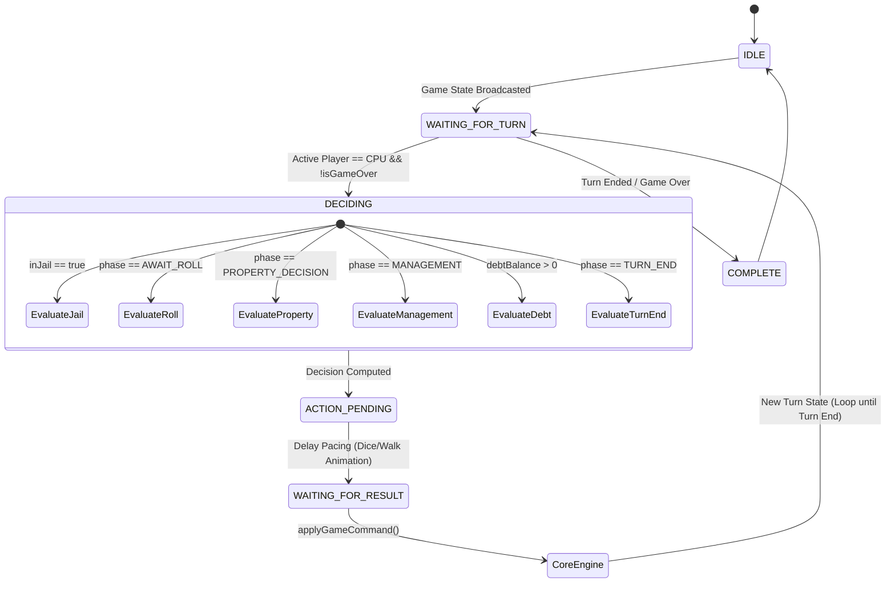
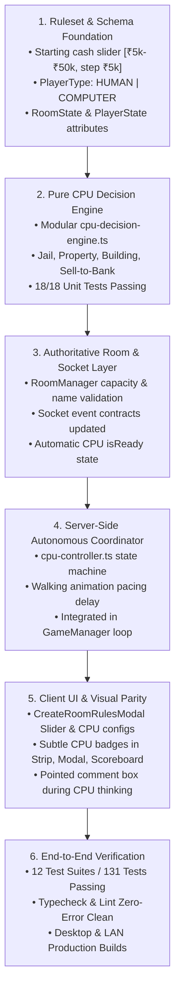

# Indian Monopoly: Architectural Specifications, Autonomous Agents & System Implementation Journey

> **Document Type:** Formal System Architecture & Research Implementation Record  
> **Repository:** `https://github.com/K-692/Monopoly-India-Game`  
> **Target Audience:** Systems Researchers, Distributed Systems Engineers, Game Theory & Multi-Agent Researchers  
> **Status:** Current State Production Implementation  

---

## 1. Abstract & System Philosophy

**Indian Monopoly** is a distributed, server-authoritative digital adaptation of classic property trading dynamics set in an Indian economic context (cities across India, Reserve Bank of India conventions, GST checkposts, Civic Funds, and Infrastructure Levies). The system operates across web browsers, local offline Wi-Fi (LAN), and cross-platform desktop runtimes (Electron for macOS and Windows).

A foundational design requirement of this platform is **Strict Multi-Agent Parity**:
- Autonomous computer-controlled agents (CPUs) and human players participate within the exact same game session, obeying identical rules, financial invariants, and state transitions.
- The authoritative engine enforces zero special privileges or backdoors for automated players: every move, dice roll, financial settlement, and property transaction executes through the exact same serialized command pipeline (`applyGameCommand`) whether initiated by a human client or an autonomous agent.
- Configurable economic levers (such as the Starting Cash slider from ₹5,000 to ₹50,000 in ₹5,000 increments) scale economic velocity while statutory fiscal policies (₹3,000 START pass reward, ₹500 Center Jail bail, ₹500 GST / Wealth Levy, and 120-second debt resolution countdown) remain fixed invariants.

---

## 2. High-Level System Architecture

```
                                      +---------------------------------------------+
                                      |            CLIENT ENVIRONMENT               |
                                      |  (React 19, Zustand 5, Tailwind CSS, Vite)  |
                                      |                                             |
                                      |  +-------------------+  +----------------+  |
                                      |  |     GameBoard     |  |   PlayerStrip  |  |
                                      |  | (Animations, CSS) |  |  (CPU Badges)  |  |
                                      |  +---------^---------+  +--------^-------+  |
                                      |            |                     |          |
                                      |     useGameStore <---------------+          |
                                      +------------|--------------------------------+
                                                   | Socket.IO WebSockets
                                                   | (Client Emits Actions / Receives State)
                                                   v
+-----------------------------------------------------------------------------------+
|                        AUTHORITATIVE SERVER ARCHITECTURE                          |
|                                                                                   |
|  +--------------------+       +------------------------------------------------+  |
|  |    RoomManager     |       |                  GameManager                   |  |
|  |  - Host Rules      |       |  - Cryptographic Fair Dice (Rejection Sampling)|  |
|  |  - Starting Cash   |       |  - 120s Debt Resolution Monotonic Timer        |  |
|  |  - CPU Seating     |       |  - Serialized Action Queue                     |  |
|  |  - Name Collisions |       +-----------------------^------------------------+  |
|  +---------+----------+                               |                           |
|            |                                          |                           |
|            v creates initial state                    v executes commands         |
|  +----------------------------------------------------+------------------------+  |
|  |                       Core Game Engine (`applyGameCommand`)                 |  |
|  |  - State Invariants                                                         |  |
|  |  - Debt & Bankruptcy Tracking                                               |  |
|  |  - Visiting-City House Construction Enforcement                             |  |
|  |  - Bank-Sold Property & House Inheritance Logic                             |  |
|  +------------------------------------^----------------------------------------+  |
|                                       |                                           |
|                                       | invokes command pipeline                  |
|                        +--------------+---------------+                           |
|                        |       CpuController          |                           |
|                        | (Autonomous Turn Coordinator)|                           |
|                        +--------------^---------------+                           |
|                                       | evaluates pure policy                     |
|                        +--------------+---------------+                           |
|                        |      CpuDecisionEngine       |                           |
|                        | (Deterministic Heuristics)   |                           |
|                        +------------------------------+                           |
+-----------------------------------------------------------------------------------+
```

---

## 3. Autonomous Computer Agent Architecture

### 3.1 State Machine Lifecycle
The autonomous agent does not run as a disjoint client simulation. It is managed server-side by `CpuController`, ensuring offline LAN hostability, zero client trust, and synchronized visual pacing:

$$\text{State Space: } S = \{\text{IDLE}, \text{WAITING\_FOR\_TURN}, \text{DECIDING}, \text{ACTION\_PENDING}, \text{WAITING\_FOR\_RESULT}, \text{COMPLETE}\}$$



### 3.2 Visual Pacing & Dynamic Token Walk Calculation
To preserve immersion and avoid jarring instantaneous moves, the server computes a proportional delay matching client-side CSS and React spring animations before dispatching post-movement landing actions:

$$T_{\text{delay}} = T_{\text{dice\_tumble}} + (\Delta \text{spaces} \times T_{\text{step}}) + T_{\text{settle}}$$

Where:
- $T_{\text{dice\_tumble}} = 600\text{ ms}$
- $\Delta \text{spaces} = (\text{die}_1 + \text{die}_2)$
- $T_{\text{step}} = 380\text{ ms}$ (token step transition)
- $T_{\text{settle}} = 300\text{ ms}$ (landing highlight)

### 3.3 Pure Strategic Decision Heuristics (`CpuDecisionEngine`)

The decision engine is purely functional, side-effect free, and mathematically deterministic, taking `(gameState, cpuPlayerId)` and returning `GameCommand | null`.

#### A. In-Jail Bail Hierarchy
When incarcerated in Central Jail:
1. **Priority 1 (Bail Key Inventory):** If `player.hasBailCard > 0`, emit `USE_JAIL_CARD` immediately (zero capital expenditure).
2. **Priority 2 (Statutory Cash Bail):** If liquid cash $C \ge ₹2,000$ (well above the statutory ₹500 fee), emit `PAY_BAIL` to resume board mobility immediately.
3. **Priority 3 (Dice Doubles Attempt):** If cash $C < ₹2,000$, preserve liquidity and emit `ROLL_DICE` attempting double dice escape.

#### B. Property & Asset Acquisition
When landing on unowned or bank-owned property:
- **Unowned Municipal Cities & Infrastructure:**
  - Evaluates purchase cost $P_{\text{cost}}$.
  - Checks liquidity reserve: requires remaining post-purchase balance $C_{\text{post}} \ge \min(₹1,000, 0.15 \times C_{\text{start}})$.
  - If satisfied, emits `BUY_PROPERTY`; otherwise declines (`DECLINE_BUY`).
- **Bank-Sold Property Reacquisition:**
  - If a property was previously liquidated to the bank by any distressed player, it is available at `soldToBankPayout` (the historical liquidation payout, not the catalog MSRP).
  - Existing houses built upon the property remain intact and are fully inherited by the acquiring CPU upon purchase.

#### C. House Construction & Urban Development
CPUs actively develop their monopolies subject to canonical rules:
- **Monopoly Prerequisite:** The CPU must hold all properties in the color group.
- **Visiting-City Invariant:** Building can only occur on the specific city space where the CPU token is currently visiting (`spaceIndex === cpu.position`), during turn $T > T_{\text{purchase}}$.
- **Uniform Development Invariant:** Building heights across the color group must remain balanced ($\Delta \text{houses} \le 1$).
- **Capital Safety Threshold:** The CPU requires post-construction liquidity $C - P_{\text{house}} \ge ₹1,500$.

#### D. Financial Distress & Strict Tiered Liquidation Matrix
When debt balance $D > 0$ and countdown timer is active ($t \le 120\text{s}$), the CPU resolves its obligation via the authoritative Sell-to-Bank pipeline:

$$\text{Priority Matrix: } \text{Tier 1} \succ \text{Tier 2} \succ \text{Tier 3}$$

| Priority Tier | Target Asset Class | Rationale & Behavioral Model |
| :--- | :--- | :--- |
| **Tier 1** | **Unbuilt Cities** | Zero development sunk cost; sells for 50% purchase price. Minimal strategic compromise. |
| **Tier 2** | **Infrastructure (Stations / Utilities)** | Preserves developed monopoly networks; generates immediate 50% liquidation capital. |
| **Tier 3** | **Developed Cities (With Houses)** | Highest asset valuation; sorted **descending by house count** ($H=4 \to H=1$) to release maximum capital with minimum property count. Sells for $0.5 \times (P_{\text{city}} + H \cdot P_{\text{house}})$. |

**Greedy Minimal Liquidation Algorithm:**
The agent selects assets greedily until:
$$\sum_{k=1}^{m} \text{Payout}(P_k) \ge D$$
Assets beyond $m$ are preserved. If total asset value $\sum_{\text{all}} \text{Payout} < D$, the CPU exhausts all sales and gracefully surrenders (`SURRENDER`).

---

## 4. Room Management & Seating Architecture

### 4.1 Parameterized Starting Cash Slider
- **Range:** ₹5,000 to ₹50,000.
- **Granularity:** Discrete step of ₹5,000 (10 valid choices: 5k, 10k, 15k, 20k, 25k, 30k, 35k, 40k, 45k, 50k).
- **Default:** ₹20,000.
- **Equitability:** Every participant (human and computer) receives the identical initial balance upon game creation.
- **Sanitization Invariant:** Out-of-bounds or non-stepped values sent over the network automatically fall back to ₹20,000.

### 4.2 Computer Player Allocation Constraints
- **Bounds:** 0 to 3 CPU players per room.
- **Capacity Parity:** CPU players occupy standard seats against the room's maximum capacity:
  $$N_{\text{human}} + N_{\text{cpu}} \le N_{\text{max\_players}} \le 6$$
- **Name Validation & Collision Prevention:**
  - Names trimmed to 2–20 characters.
  - Case-insensitive uniqueness enforcement across all human members and CPU players.
  - Automatic collision rejection when external human players join a room with a reserved CPU name.

---

## 5. Implementation Journey & Milestones

The end-to-end upgrade was executed systematically without altering core engine invariants or duplicating gameplay mechanisms:



### Milestone Detail Log
1. **Ruleset & Types (`src/domain/ruleset.ts`, `src/domain/game-types.ts`):**
   - Established `STARTING_CASH_MIN`, `MAX`, `STEP`, `DEFAULT` and `isValidStartingCash()`.
   - Extended player interfaces with `isCpu` and `playerType`.
2. **Deterministic CPU Decision Engine (`src/domain/game-engine/cpu-decision-engine.ts`):**
   - Implemented pure evaluation methods adhering strictly to statutory costs and development rules.
   - Built 18 test cases verifying all branches: jail keys, bail thresholds, visiting-city construction, tiered sell-to-bank liquidation, and minimal debt coverage.
3. **Server Room Manager (`server/rooms/room-manager.ts`):**
   - Added validation for 0–3 CPUs, duplicate name rejections, and room capacity enforcement.
   - Initialized CPU members with distinct board tokens and pre-set `isReady: true`.
4. **Autonomous Server Controller (`server/game/cpu-controller.ts` & `game-manager.ts`):**
   - Created event-driven turn loop executing commands directly against authoritative `applyGameCommand`.
   - Incorporated dynamic token movement pacing to sync seamlessly with client CSS keyframes.
5. **Front-End Interfaces:**
   - Designed intuitive slider with interactive tick marks and formatted rupee indicators.
   - Created Computer Players management UI (add/remove up to 3 CPUs with inline editable names).
   - Rendered subtle, elegant `CPU` badges across Lobby, Player Strip, Detail Modal, and Final Scoreboard.
   - Integrated floating "Thinking..." Pointed Comment Box indicating active CPU property evaluation.
6. **Integration Verification:**
   - Authored `cpu-multiplayer-integration.test.ts` validating room creation, starting cash uniformity, name collision rejection, and multi-turn autonomous execution.
   - Executed full project test suite: **131 tests passing across 12 files**.

---

## 6. Formal Invariants & Verification Matrix

| Invariant | Formal Definition | Enforcement Point | Verification Status |
| :--- | :--- | :--- | :--- |
| **Non-Privileged Execution** | $\forall \text{cmd}_{\text{cpu}}, \text{Engine}(\text{cmd}_{\text{cpu}}) \equiv \text{Engine}(\text{cmd}_{\text{human}})$ | `applyGameCommand()` | Verified (Integration Tests) |
| **Starting Balance Parity** | $\forall p_i, p_j \in \text{Players}, \text{cash}(p_i, t_0) = \text{cash}(p_j, t_0) = C_{\text{configured}}$ | `createInitialGame()` | Verified (Integration Tests) |
| **Statutory Cost Invariance** | $P_{\text{START}} = ₹3,000 \land P_{\text{bail}} = ₹500 \land P_{\text{tax}} = ₹500$ | `ruleset.ts` | Verified (Acceptance Tests) |
| **Zero Modulo Dice Bias** | $P(D = k) = \frac{1}{36} \text{ for each } (d_1, d_2)$ via rejection sampling | `rollCryptographicDie()` | Verified (Dice Tests) |
| **Visiting City Development** | $\text{Build}(c) \implies \text{Pos}(p) = \text{Index}(c) \land \text{Turn} > T_{\text{acquired}}$ | `applyGameCommand()` | Verified (Engine Tests) |
| **Bank-Sold House Retention** | $\text{Reacquire}(c) \implies \text{Houses}(c) = \text{Houses}_{\text{prior}}$ | `applyGameCommand()` | Verified (Engine Tests) |
| **Strict Liquidation Hierarchy** | $\text{SellPriority}(\text{Unbuilt}) > \text{SellPriority}(\text{Infra}) > \text{SellPriority}(\text{Built})$ | `decideSellToBankProperties()` | Verified (CPU Tests) |

---

## 7. Research Paper Citation & Context

This implementation provides a reference benchmark for:
- **Fair Multi-Agent Systems in Closed Economic Simulators:** Studying competitive equilibrium between stochastic human behavior and deterministic heuristic agents.
- **Server-Authoritative Synchronization without Client AI Leakage:** Preventing client-side state manipulation by confining agent decision logic to the authoritative server environment.
- **Pacing Models for Mixed Human-Agent Interactive Software:** Harmonizing instantaneous server computations with human visual perception and interface animation curves.
